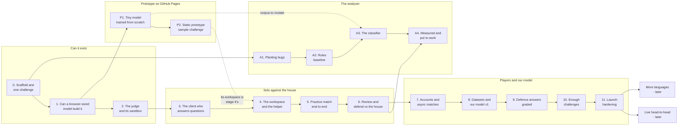

# codevscode - Build plan

## Objective

**A game where two coders build the same small app with an AI helper, and win by the
questions they ask, the bugs they find and how well they defend what was built - not by who
typed fastest.** The helper writes the code. The player is the lead and the quality analyst:
they question the client, direct the helper, check its work against a checklist of security,
efficiency, practicality and correctness, then review the other player's app and answer for
their own.

The author's words: "the goal isnt to just to build the code but to satisfy a checklist of
security, efficiency, practicality, more from a quality analyst, teaching what type of
questions to ask, code reviews, finding bugs in codes they havent written", and "this is more
about asking and answering the right questions, being able to defend an app that someone else
builds which is the AI assistant."

This is the author's biggest project and the one meant to launch, so launch concerns -
players, abuse, cost per match, licences, the name - are in scope from the start, not bolted
on at the end.

Finished, for the first version, when seven things are true:

1. Someone who is not the author plays a practice match start to finish in a desktop browser,
   with nothing to install, against the house.
2. The helper is a model we trained - a fine-tune of an open-weights model on data we put
   together - and the harness shows whether it beats the model it started from on challenges
   it never saw. If it does not, the README says so and the better one ships.
3. Asking changes the outcome: a hidden requirement is told to a player only when they ask
   about it, and how well the question matcher does is measured on questions labelled by hand.
4. Every bug report that scores comes with a failing test, and that test passes on the
   challenge's reference app. Nothing is scored on someone's say-so.
5. Two real players finish an asynchronous ranked match, coach off, and each gets a score
   card that says where their points came from.
6. A hostile submission - an endless loop, a fork bomb, a network call, a huge output, an
   attempt to read the hidden tests - is contained, and a test proves it for each.
7. It is live on the portfolio's one server with no per-request cost: the model runs in the
   player's browser, the server only judges and keeps score.

There are no dates in this plan. Stages are ordered by what each one needs from the one
before it.

## Order of work

| Stage | Goal | Done when |
| --- | --- | --- |
| 0 | Scaffold and one challenge | FastAPI, Docker Compose with PostgreSQL, Alembic, `/health` green from PowerShell, a CI workflow running pytest against a real database. The challenge format written down and a validator for it, and one test runner shared by the browser, the validator and the judge. One challenge written by hand - brief, interface, hidden requirements, reference app, hidden tests, house app with planted bugs - **and the hours it took recorded**, because that number decides how many challenges a launch can have |
| 1 | Can a browser-sized model build it | On Colab: three or four candidate open-weights coding models, each given the stage 0 challenge through scripted conversations with the game's own prompt, the app it writes run against the hidden tests - first all of them at full precision (the ceiling), then the finalists converted by us to the browser's 4-bit format and measured again, so the cost of 4 bits is a number too. Recorded per model: tests passed, download size. Then the best one or two opened in a real browser once, to confirm they load and to measure speed on an ordinary machine. **The conversion is ours, not a prebuilt download**, so the path stage 8 needs is proven now. The result sets the size of a challenge and picks the baseline: the smallest model that passes |
| P1 | A tiny model trained from scratch | On Colab: a corpus of small apps in the game's app shape, generated by an open-weights teacher and kept only when they parse and run; our own tokenizer trained on it; a small decoder-only model (a few million to a few tens of millions of parameters) trained from nothing; exported to ONNX at 8 bits, small enough for GitHub Pages. Measured by the same harness as every other model: how much of the sample it passes, how often its JavaScript is valid at all |
| P2 | A static prototype on GitHub Pages | The workspace in a static mode: the sample challenge only, the tiny model as the helper, questions matched in the browser, tests run in a browser worker by the shared runner, a score card. No server, no accounts. Live at `/codevscode/` on the portfolio while the real game is built. Challenges are public in the repo anyway, so shipping the sample's hidden half in a static page gives nothing away |
| A1 | Planting bugs | Twelve mutation operators - each a real mistake: a query built from text, a dropped ownership check, an uncapped limit, a missing index, a flipped boundary, a removed guard - applied wherever they fit in a reference app, each mutant run against the hidden tests in its own process. Gives the author a mutation score and a list of what the tests miss, and gives the analyzer rows labelled by construction and confirmed by the tests. **Built** |
| A2 | Rules baseline | Hand-written checks over the source for the same kinds of mistake, scored on the same rows. The number the classifier has to beat |
| A3 | The classifier | A small code encoder (around 125M parameters) fine-tuned on Colab to read one function and name the checklist categories it is likely to fail. Trained on mutants of the train-split challenges and of the P1 corpus, never a public dataset. Exported to ONNX at 8 bits for the browser |
| A4 | Measured and put to work | Classifier against rules on held-out challenges, per category, in the README whichever wins. Then wired in where it is advisory only: practice hints, the post-match "what you missed", and aiming the house's findings. Never in ranked review, never the judge |
| 2 | The judge and its sandbox | A queue and a worker that run a submission's tests in a container with no network, a read-only filesystem, and limits on time, memory, processes and output. The reference app passes every hidden test; the house app fails exactly its planted bugs and nothing else. Hostile submissions contained, one test each. Stuck jobs reclaimed and failed jobs retried - designed in now, not found later |
| 3 | The client who answers questions | A player's question is matched against the challenge's hidden requirements on the server; a match reveals the author's answer, no match gets a neutral reply. Hidden material never reaches the browser. The matcher measured on a set of questions the author labels by hand: how often a right question is answered, how often a wrong one gives something away |
| 4 | The workspace and the helper | A browser page with the brief, the questions panel, the helper chat, an editor, a live preview of the app and a local test run. The helper is the best stage 1 model, running in the browser, with the name the player gives it. The coach is on in practice |
| 5 | Practice match end to end | Brief, ask, build, submit, judged, score card - against the clock, against the house, with no account. The first thing worth showing anyone |
| 6 | Review and defend against the house | The player reviews the house app and files findings, each with a failing test; a finding counts only if the reference app passes it and the house app fails it. The house files its own findings against the player's app; the player fixes or concedes each one. The score card gains a review and a defence line |
| 7 | Accounts and async matches | Sign-in by email link. Two players paired on the same challenge; each builds alone; then a review window and a defence window; then the result. Ranked mode with the coach off |
| 8 | Datasets and our model v1 | Training data assembled with every source's licence recorded. A fine-tune trained on Colab, converted for the browser by the stage 1 path, and run through the harness against the base model on challenges it never saw. It ships only if it wins, and the README reports the numbers either way |
| 9 | Defence answers graded | Reviewers can ask questions as well as file findings, and each challenge carries the author's own defence questions. Answers are graded against the author's key points by a local entailment model, and the grader is measured against the author's own grades before it counts toward anything |
| 10 | Enough challenges | An authoring checklist and tooling that cut the hours stage 0 measured. As many challenges as a launch needs - the number set from stage 0's authoring time and how often a player would repeat one |
| 11 | Launch hardening | Rate limits, reporting and moderation of helper names and free text, consent for training on transcripts, terms and privacy pages, licences checked for every model and dataset, the name checked, real email, backups proven by a restore |

**Stages 0, 1, A1, 2 and 3 are done.** Stage 0: the scaffold, the challenge format and its
validator, the shared runner, the sample challenge "Team notes" (42 hidden tests). Stage 1:
five Colab runs; with a scaffolded starter and repair turns that see what a player sees, the
7B teacher builds a crash-free app passing 20 of 42 and the best browser-sized model reaches 12
- see the gate below. A1: bug planting and the mutation score. Stage 2: the judge - a jobs
queue with a reaper and retries, and a sandbox container that contains every kind of hostile
submission tested. Stage 3: the client - questions matched by a local sentence model (16 of 28 labelled questions
unlocked with no false reveal, against 2 for word matching), attempts, limits, and a test that
nothing hidden leaks. Stage 4 (the workspace) is next; P1 waits on GPU time.

### Why "can a model build it" comes before anything else

Every other part of the game assumes the helper can build a small app well enough to be worth
reviewing and badly enough to be worth questioning. A model small enough to download into a
browser may not manage either. herder and mailman both found their local model losing to
something simpler; here there is no simpler thing to fall back to, so the question is asked
at stage 1, with one hand-written challenge, before the loop is built around an answer nobody
has measured. If no candidate can build the sample app, challenges shrink - the helper writes
functions inside a scaffold instead of whole apps - and the rest of the plan follows that.

### Why the judge comes before the game

Every point in the game comes from a test that ran in the sandbox. Running strangers' code on
a server is also the most dangerous thing the project does. Both are reasons to build and
attack it before there is a page to play on.

### Why a from-scratch prototype, and why on Pages

The author's idea: "a small from scratch model would be a good prototype for github pages
while it waits till i host the models." It answers two things at once. It puts something
playable live early, on the free static host the portfolio already has, with no server and no
model hosting. And it is the project's honest "trained from nothing" result: a model built
entirely by us, from the tokenizer up, measured by the same harness as the fine-tune and the
base model. Nobody should expect it to build the app well - a model that size, trained on a
narrow corpus, writes code that looks right more often than it works. In this game that is
playable: catching the helper's mistakes is the point.

It follows the TinyStories result (very small models trained on a narrow, simple, synthetic
corpus can stay coherent inside that domain), with "small apps in one fixed shape" as the
domain. The corpus is generated by us from an open-weights teacher on Colab, so it keeps the
own-data rule.

### Why the house comes before players

An async game with no players is an empty room. The house - the reference app with planted
bugs, and a set of findings the author wrote against common mistakes - means a single player
gets a whole match on the first day, and a new player always has an opponent.

### Why our model comes after the game works

Training is only worth doing against a measurement, and the measurement is the game: does
the helper's app pass more hidden tests on challenges it never saw. Stage 1's base model is
the baseline the fine-tune has to beat; stages 2 to 7 build the thing that scores it.

## Decisions settled by the author

| Decision | Reason |
| --- | --- |
| Working name Code vs Code; folder `codevscode` | "code vs code is the initial name i have for this" |
| Two coders compete on building the same app | The first brief |
| The checklist decides, not just working code: security, efficiency, practicality and more, from a quality analyst's point of view | "the goal isnt to just to build the code but to satisfy a checklist" |
| It teaches what questions to ask, code review, and finding bugs in code the player did not write | The first brief |
| Each player has an AI helper and names it whatever they like | "each coder will have a helper which is the assistant and they can name it whatever" |
| The helper writes the code; the player asks and answers the right questions and defends the app the helper built | "this is more about asking and answering the write questions, being able to defend an app that someone else builds which is the AI assistant" |
| No coaching in competition. Coaching is included for now and disabled during competition | "no coaching but we can include coaching for now then disable it during the competition" |
| Our own model, no hosted model, no paid tokens | "i want to build my own llm for the coding. no tokens". The repo-wide rule: never a provider key |
| Look into datasets, or whatever is best, to make our own model that can produce code and build things | The author left the method open: "datasets or whatever you believe is best" |
| A website in the browser | "website browser" |
| A light engine, where that is possible | "soft engine as in lightweight engine only if its possible". Light means: the smallest model that passes the stage 1 gate, a plain JavaScript workspace with no framework and no build step, server-rendered pages everywhere else. Lightness never overrules the gate - a helper too weak to build the app is not a lighter game, it is no game |
| Players can type code by hand | "players can ofc type by hand". The helper is the main way to build, not the only one |
| All model work happens on Colab; the author's own GPU does not matter | "my machine gpu doesnt matter, i want to work on collab for this". Training, conversion and the harness run on Colab. The only thing a home machine does is open the game in a browser, like any player |
| The helper that ships is a fine-tune of a small open-weights coding model | "go for fine tuning" |
| A small model trained from scratch is the prototype on GitHub Pages, until the real game and its models are hosted | "a small from scratch model would be a good prototype for github pages while it waits till i host the models" |
| Challenges live in the repo whole, hidden halves included | "the hidden halves can live on the portfolio fine. no need to hide it." Anyone who looks can read the hidden requirements and tests; the game server still never sends an unrevealed one to the browser, so a player has to go looking. Held-out challenges stay held out because our training pipeline never reads them, not because they are secret |
| The model is called **cvchelper**, always described as fine-tuned from its base: "cvchelper, fine-tuned from Qwen2.5-Coder-1.5B" (or whichever base wins stage 1), never "our own LLM" on its own. Published versions carry size and version: `cvchelper-1.5b-v1` | The name is the author's: "call it the cvchelper model". The wording answers the author's own question "would it be a good idea to say its my own llm?": the fine-tune, its data, the teacher pipeline and the harness are the author's work and the stronger claim; "my own LLM" alone invites "trained from scratch?" in an interview, and the base's licence requires saying it was modified. If the fine-tune loses and the base ships, the game says it runs the base unchanged. Players' own names for their helper are separate and cosmetic |
| A code analyzer: a second model of ours, a small code classifier, trained on a dataset the game makes itself | "yes and go for the game makes its own dataset with a small code classifier". No public bug datasets, for training or testing |
| Stage 1's gate: cvchelper is fine-tuned from Qwen2.5-Coder-1.5B; the teacher is Qwen2.5-Coder-7B; challenges stay the size of "Team notes" | "go for it" (to the proposal after run 5). The 1.5B is the best browser-sized model (12 of 42); the 7B the only one to finish crash-free (20 of 42) |
| Teacher conversations are kept when the app runs crash-free through the walk-through and passes at least half the hidden tests (bar to tune), from several sampled attempts per challenge; A1's mutant -> reference pairs are a second training source | The same answer. "Passes the hidden tests" would keep nothing - no model passes all 42. The mutation pairs are perfectly labelled and need no teacher |
| Model weights hosted on a public Hugging Face repo | "hugging face account is fine". A file host, like GitHub: uploaded once, downloaded by players' browsers, no model called through it, no key at play time |
| The first model is trained on our own data; public datasets are left out unless needed later | "lets leave public datasets unless we need them later". Our challenges and teacher conversations generated on Colab carry v1; public sets wait in reserve (04-data-model). Hosted-model-written sets are out entirely |
| Asynchronous matches first, live head-to-head later | "async mode for now, head to head later" |
| The author's biggest app, meant to be finished and launched | "this would be the one i want to complete and hopefully launch one day" |
| Planned first in a requirements folder, before code | "go for it", after the plan-first proposal |

## Decisions proposed, waiting for the author's confirmation

| Decision | Reason |
| --- | --- |
| A match has four phases: ask, build, review, defend | Ask and build are the player with their helper; review and defend are the player against the other app. Each phase is something the brief names |
| Hidden requirements: the brief is short and vague on purpose, and the client tells a requirement only to someone who asks about it. Hidden requirements are judged whether or not they were asked about | That is how "what questions to ask" gets scored without anyone grading prose: asking reveals what will be tested |
| The client is scripted, not a model: questions are matched to the author's hidden requirements by a small local sentence model, and the answer is the author's own words | A generative client could make up requirements, contradict itself, or leak the test list. Matching is measurable, cheap, and cannot hallucinate |
| A finding counts only with a failing test, and only if the reference app passes that test | Makes review objective and makes "that's not a bug, the brief never asked for it" settle itself: if the author's own app fails the test too, the test asks for something the challenge does not |
| Every challenge fixes the interface - routes, function names, data shapes - and leaves everything behind it free | One test has to run against both players' apps and the reference |
| Defending a finding is fixing it (with the helper) or conceding it. A fix counts if the finding's test now passes and no hidden test breaks | A defence that can be checked. Free-text defence answers come at stage 9, graded and measured separately |
| A weak helper is part of the game, not a flaw in it | The player is the quality analyst for their own helper too: catching what it got wrong is the skill being taught |
| Speed counts, but a little: a time limit per challenge, and unused time is worth a small share of the score | The first brief mentions "the fastest"; the rest of it says quality wins. A big speed weight would teach rushing |
| The coach is rules, not a model: it nudges by checklist category ("nothing asked about scale yet") without giving answers. Practice mode only | Keyless, predictable, and trivially disabled for ranked play |
| The same helper model for everyone in a match; the name is cosmetic | Fairness. The helper's name never changes what it does |
| The helper runs in the player's browser on WebGPU | No server GPU, no per-request cost; the one server judges and keeps score. A launch with real players cannot afford inference on the server |
| Our model = a small open-weights coding model, fine-tuned by us with QLoRA on Colab, on data we assemble | The only path that gives a helper able to write a working app inside a browser download. See "What our own model means" and "Shipping the helper" in 03-architecture, and the open question |
| The harness runs the 4-bit browser build of each model, on Colab's GPU through the same runtime family | Measure the thing that ships. A full-precision model on Colab can pass tests its 4-bit browser copy fails |
| Every challenge's starter is a scaffold: routing, body parsing and answers done, each route a stub; every checklist decision left to the player and the helper | Stage 1's first run: every candidate scored 0 of 42, mostly by importing modules and misreading the app shape, not by failing to code. The plan's own response to "no model can build the app" was to shrink the job to functions inside a scaffold. It helps players as much as helpers |
| The harness gives a helper up to two repair turns carrying what the workspace shows when the app does not run (load and schema errors, crashes) - never hidden test results | A real player sees those errors at once and pastes them; a harness without that loop measures a game nobody plays |
| Teacher-sized models (Qwen2.5-Coder 7B and 14B at 4 bits) are measured alongside the candidates | A teacher's conversations are only kept if its app passes the hidden tests. If no teacher passes, the training-data plan changes before anything is trained |
| Players' apps are plain JavaScript: a request handler with an in-memory SQLite database, and a small front end | One language for the first version. JavaScript runs in the browser for the preview and in Node for the judge, and a database is what makes real security items possible: injection, auth, password storage |
| Python, FastAPI, PostgreSQL, Docker Compose, Alembic, server-rendered pages plus one JavaScript workspace page | roamer's and mailman's stack: the deploy, CI and test patterns exist, so the effort goes into the game |
| The judge runs each submission in a container: no network, read-only root, a non-root user, limits on CPU time, memory, processes and output, one job at a time per worker | Untrusted code on the same server as everything else. Defence in depth, each layer tested |
| Judge jobs have a reaper and retries from the first version | herder's derive jobs had neither and wedged silently. Same shape, same mistake avoided |
| Sign-in by email link, no passwords | roamer's pattern. Async play needs to know who is who, and a password store is one more thing to secure |
| Transcripts become training data only with a player's explicit opt-in | The app will be a data collector for the model, as roamer is for its future model. It has to ask |
| Every model the helper has ever been is recorded, and every attempt records which one it used | herder's `model_calls` lesson: "which model produced this" must be answerable after the fact |

## Open questions

| Question | Blocks | Notes |
| --- | --- | --- |
| Which mutant labels does the classifier learn from? | A3 | A mutant has two labels: the category its operator declares (what we broke) and the categories the hidden tests saw fail. They disagree when the tests miss a mutant - 52 of the sample's 120. Proposed: declared labels for operators that are a flaw whatever the tests say (SQL from text, weak random, missing index or UNIQUE), test-confirmed labels only for the rest (a flipped boundary nobody can observe may change nothing) |
| How big is the tiny model, and how big its corpus? | P1 | Set by Colab time: generating the corpus is the slow part. A first guess is 10 to 30 million tokens of corpus and a model of 5 to 30 million parameters |
| How are questions matched on the static prototype? | P2 | Proposed: a word-overlap scorer over the phrasings first (no download at all), and a small sentence model in the browser only if it measures better on the labelled questions |
| Which teacher model generates the training conversations? | Stage 8 | A bigger open-weights coding model that fits a Colab T4 in 4-bit (a 7B, perhaps a 14B), with a licence that allows training on its outputs. Picked by how many teacher conversations pass the hidden tests |
| Can a player see the opponent's helper conversation after the match? | Stage 7 | Proposed: no, private by default. It would be the best teaching material in the game, so perhaps opt-in sharing later |
| What happens to pasted code from outside the game? | Stage 7 | It cannot be stopped in an async browser game. Proposed: allowed, counted, and shown on the score card; the scoring leans on review and defence, which pasting does not help. Typing by hand is normal play and is not shown |
| What happens without WebGPU? | Stage 4 | Options: a slow CPU fallback for practice only; or watch-only. Most current desktop browsers have it; phones are out of scope for building |
| How long is a challenge? | Stage 1 | Set by stage 1's numbers - how big an app the helper can build and how fast it writes. A first guess is 30 to 45 minutes of build time |
| How are two players paired? | Stage 7 | Proposed for the first version: first come, first paired on the same challenge; a second-comer is paired with the earliest waiting attempt; past seven days, the house steps in |
| Is the name safe to launch with? | Stage 11 | "VS Code" is a Microsoft trademark; "Code vs Code" reads as "versus" but the folder name and any logo should not lean on Visual Studio Code. Checked before launch, not now |

## Risks

| Risk | Effect if it happens | Response |
| --- | --- | --- |
| No browser-sized model can build a small app | The game has nothing to review | Measured at stage 1 with one challenge, before anything else is built. Shrink challenges to functions inside a scaffold if needed |
| A submission escapes the sandbox | The server, the database and every other project on it are exposed | Container with no network, read-only, non-root, limited; the judge never shares a network with the database; hostile submissions in the test suite; the judge reads hidden tests from a volume mounted read-only into the job, never the database |
| A player reads the hidden tests in the repo before playing | That player knows every hidden requirement without asking | Accepted by the author: challenges are public. The server never volunteers them, so it takes going to look. If it matters after launch, new challenges can be kept out of the repo from then on - the format does not change |
| A future base model is trained on the public challenges | A held-out challenge stops measuring what it should for that model | Held-out results are reported per base model; a new base model can be given challenges written after its training cutoff |
| Challenges take too long to write | A launch with three challenges is not a launch | Authoring time measured at stage 0; tooling at stage 10; the house app and findings come from the reference by planting bugs, not by writing a second app |
| The question matcher is either too strict or too loose | Good questions are ignored, or vague ones give everything away | Measured against hand-labelled questions at stage 3; each requirement carries several phrasings; a threshold per challenge |
| Our fine-tune loses to the base model | Months of training with nothing to ship | The harness decides; the base ships if it wins, and the README says so. The same finding has happened in mailman and herder, and saying so is the portfolio story |
| Our own data is too little or too narrow | The fine-tune memorises the train challenges and wins nothing on held-out ones | Held-out numbers are the only ones reported; teacher conversations give volume and variety per challenge; every new challenge adds data. If it still loses, the reserve datasets are the next decision, not an automatic step |
| The model download is too big | Players leave before it finishes | Download size is a stage 1 measurement; the smallest model that passes the gate; a progress bar and the brief and ask phase playable while it loads |
| Licences: a model or dataset forbids what launch needs | Relaunch or retrain | Every model and dataset row records its licence; checked at stage 8 and again at stage 11 |
| Abuse: offensive helper names, hostile review questions | Players leave | Free text from other players is limited to findings and questions, with a report button and author moderation; helper names checked against a list |
| The scope swallows the project | It is never finished | The stage gates. Live head-to-head and more languages are explicitly after stage 11. The tiny model is a prototype with its own two stages, and the analyzer four, not second products |
| Too few labelled rows for the classifier | It learns the sample's functions by heart and wins nothing on held-out challenges | One challenge gives about 140 rows. The volume comes from mutating the P1 corpus (thousands of apps in the same shape), labelled by the operator; every new challenge adds test-confirmed rows. Held-out numbers only |
