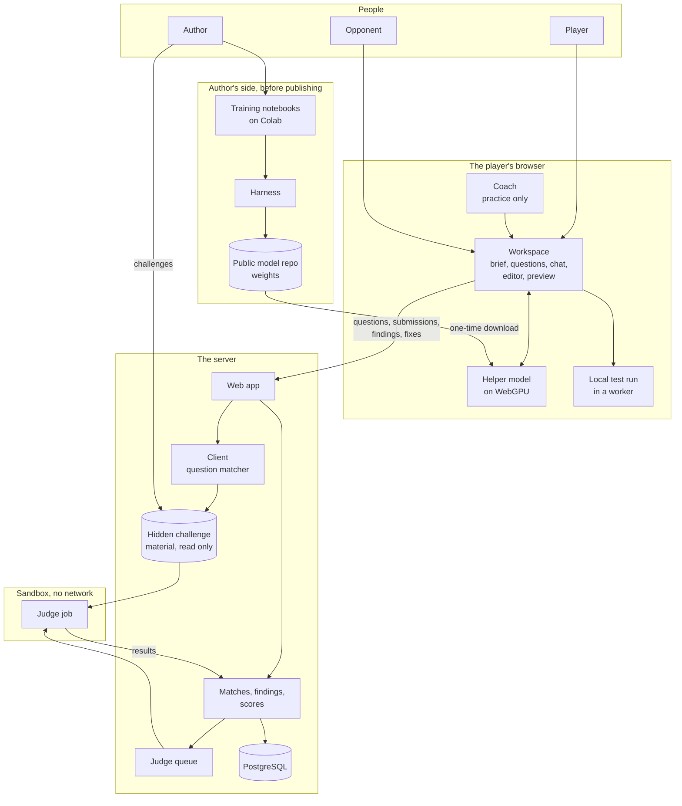
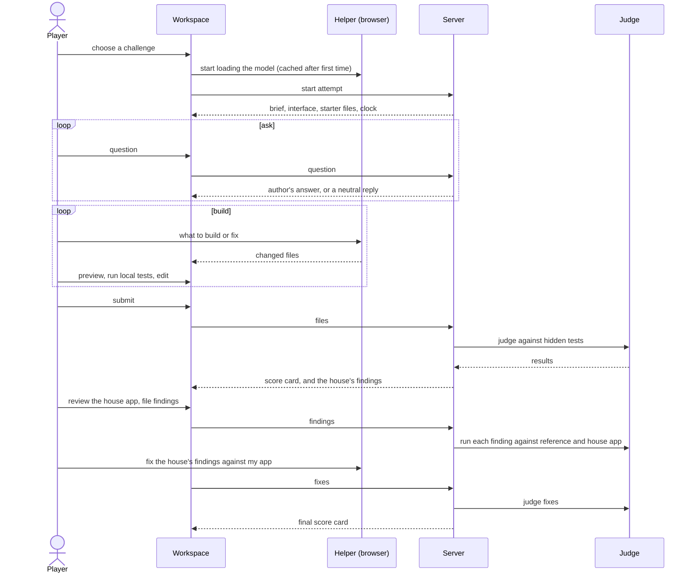

# codevscode - Interaction and system boundary

## Actors

| Actor | Type | What they want |
| --- | --- | --- |
| Player | Human, the public | To take a challenge, question the client, build with their helper, and come out with a better score than last time |
| Opponent | Human, the public | Another player on the same challenge. Reviews the player's app and defends their own |
| Learner | Human, the public | A player in practice mode, using the coach to learn what to ask and what to look for |
| Portfolio visitor | Human, the public | To see it work in a few minutes: a practice challenge against the house, the score card |
| Author | Human | Writes challenges, trains and measures the helper model, moderates, hosts |
| Helper | System, in the player's browser | The coding model. Writes and changes code when the player asks. Knows only what the player has told it and what the client has revealed |
| Client | System, on the server | Answers questions about the brief from the author's hidden requirements. Never invents anything |
| House | System, on the server | The opponent when there is no human one: the author's reference app with planted bugs, and the author's prepared findings |
| Judge | System, on the server | Runs tests against submitted apps in a sandbox and reports what passed |

## Interaction diagram

What crosses from the browser to the server: questions to the client, the app's files at
submission, findings (a claim and a test), fixes, and with opt-in consent, the helper
conversation. What never crosses from the server to the browser: hidden requirements the
player has not asked about, hidden tests, the reference app, the house's planted bugs.

## What the system is in the business of

- Teaching the questions a lead or a quality analyst asks before, during and after a build.
- Making every point checkable: a test that ran, an answer that was revealed, a fix that
  passed. Nothing is scored on anyone's opinion, including the author's at match time.
- Giving every player the same helper, so the difference between two apps is the person.
- Running untrusted code safely.
- Owning its model: trained by us, measured by us, run on the player's machine.
- Being worth playing alone, from the first day, against the house.

## What the system does not care about

- Typing speed, lines of code, or keystrokes per minute.
- Algorithm puzzles, competitive-programming tricks, or language trivia.
- More than one language in the first version. Players' apps are plain JavaScript.
- Frameworks. No React, no build tools inside a challenge.
- Big apps. A challenge is as small as the helper can build well - stage 1 decides.
- Hosted AI of any kind: no provider, no key, no per-request cost, no "bring your own model".
- Stopping a determined cheater in async play. Pasting is counted and shown, not prevented.
- Live, real-time play in the first version.
- Chat between players. The only thing players send each other is findings, questions about
  the app, and the answers to them.
- Money, prizes, payments, ads.
- Deploying what players build. Apps live inside the game and nowhere else.
- Building on a phone.
- Remembering a player's code forever. Old attempts can be deleted by their owner.

## Use cases

| Use case | Actor | Outline |
| --- | --- | --- |
| Take a practice challenge | Learner | Choose a challenge, read the brief, ask, build with the helper and the coach, submit, get judged against the house |
| Name the helper | Player | Once, at first visit; changeable. Checked against a word list |
| Ask the client | Player | Type a question; get the author's answer if it matches a hidden requirement, or a neutral reply. Every question and its outcome is kept for the score card |
| Build | Player | Talk to the helper, read and edit the files, run the preview and the local tests, submit before time runs out |
| Enter a ranked match | Player | Signed in; coach off; paired with the next player on the same challenge, or with the house after a waiting period |
| Review | Player | Read the opponent's submitted app, write a finding with a category, a short claim and a test; the server checks the test against the reference and the opponent's app before it counts |
| Defend | Player | For each valid finding against them, fix it with the helper or concede. A fix is judged |
| Ask about the app | Player | Stage 9: a reviewer asks why something was done; the defender answers; graded against key points |
| Read the score card | Player | Points by category, the questions that paid off, findings made and received, fixes, time |
| Report | Player | Report a helper name, a finding's claim or an answer as offensive |
| Write a challenge | Author | Brief, interface, hidden requirements with phrasings and answers, reference app, hidden tests, planted bugs, house findings; the validator passes; published to the hidden store |
| Train and ship a model | Author | Assemble data, train on Colab, convert, run the harness, publish the weights only if they win |
| Moderate | Author | Review reports, hide content, suspend an account |

## Journeys

### A practice match against the house

### An asynchronous ranked match

1. Player A starts a ranked attempt. The coach is off. They ask, build and submit; the judge
   scores the app privately. A is now waiting.
2. Player B starts the same challenge, days later. On submission, B is paired with A.
3. The review window opens for both, two days by default. Each reviews the other's app and
   files findings. Each finding is checked as it is filed, so a reviewer knows at once
   whether it counts.
4. The defence window opens when review closes. Each player fixes or concedes every valid
   finding against them.
5. When defence closes, both score cards are published to both players.
6. If nobody is paired with A within seven days, the house becomes A's opponent.
