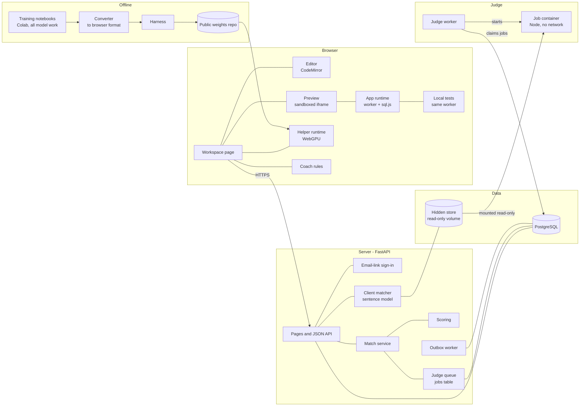
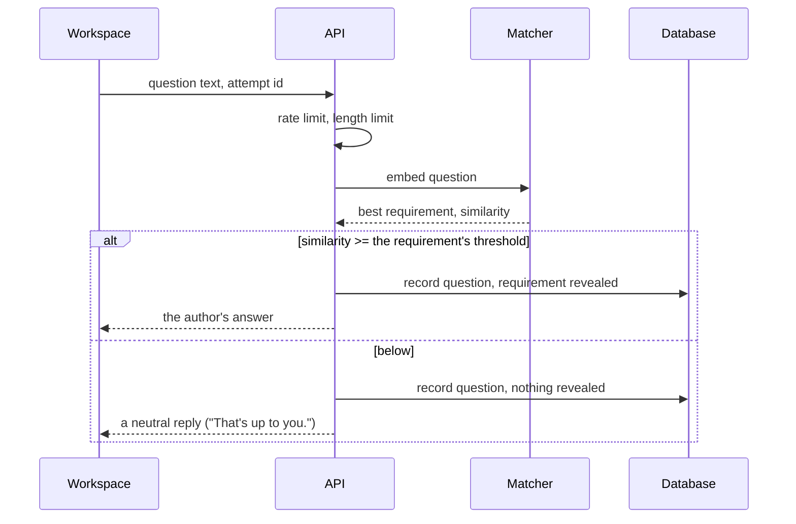
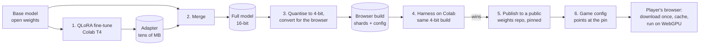
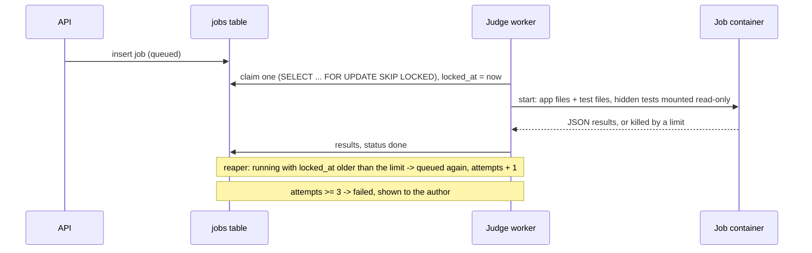
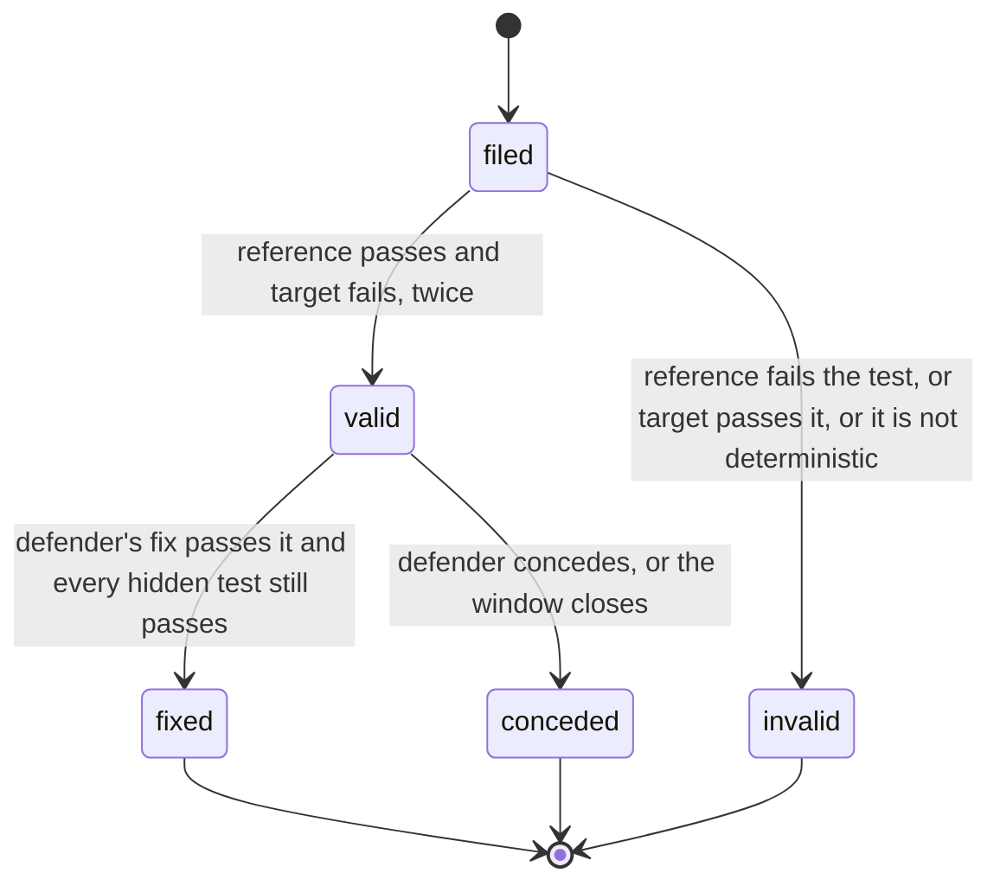
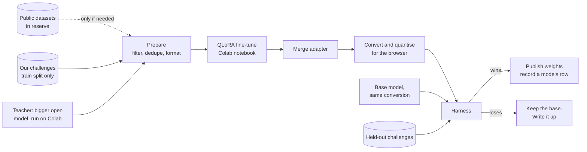

# codevscode - Architecture

Nothing here is built. Everything below is a proposal until 00-plan's settled table says
otherwise, and the stage 1 measurements may change the shape of the helper and the size of a
challenge.

## Components



| Component | Runs where | Job |
| --- | --- | --- |
| Workspace page | Browser | The one JavaScript-heavy page, plain ES modules with no build step (`web/`). Brief and interface (a small escaping Markdown renderer), question panel, clock, file editor, preview, "Try it". Built at stage 4a; the helper chat is 4b. Served at `/play/<slug>` |
| App runtime | Browser, a worker | `web/app-worker.js`: the player's app on the shared runner and the same sql.js build as the judge (vendored, a test checks the bytes match), in a worker so an endless loop freezes the worker and not the page - after 5 s it is thrown away and a new one started. The preview is the player's index.html in an iframe sandboxed without an origin; `web/bridge.js` replaces its fetch() with messages to the workspace, which hands each request to the worker. Built at stage 4a |
| Helper runtime | Browser | Loads the model weights once into the browser's cache and generates on WebGPU. WebLLM is the first choice, transformers.js the second; stage 1 picks |
| Coach | Browser | Rules over what the player has done so far. Practice mode only; the ranked workspace does not load it |
| Client matcher | Server | Embeds a question with a small sentence model and compares it with every hidden requirement's phrasings. Server-side so hidden material never ships |
| Match service | Server | Attempts, pairing, windows, findings, defences, the house |
| Judge queue and worker | Server | A jobs table and a worker process that runs each job in a fresh container |
| Scoring | Server | Pure functions from judged results to a score card. No model involved |
| Training, converter, harness | Offline | Colab notebooks, the browser-format conversion, and the harness that decides whether a model ships |

## The challenge

A challenge is a folder. The public half is safe to send to the browser; the hidden half
never leaves the server. The format is in 04-data-model; the shape:

| Part | Public | Written by |
| --- | --- | --- |
| Brief: a few sentences from the client | Yes | Author |
| Interface: the routes or functions the app must expose, with their shapes | Yes | Author |
| Starter files: a scaffold - routing by a route table, JSON body parsing, reply and fail, a bearer-token helper, each route a stub answering 501 - plus a minimal front end and a schema stub. Every checklist decision is left open | Yes | Author |
| Hidden requirements: each with a category, several phrasings of the question that unlocks it, the client's answer, and the tests that check it | No | Author |
| Reference app: a correct, secure, efficient answer | No | Author |
| Hidden tests: spec, security, efficiency and practicality tests, each tagged with a requirement and a category | No | Author |
| Planted bugs: patches against the reference that make the house app | No | Author |
| House findings: tests that catch common mistakes, filed against players' apps when the house is the opponent | No | Author |
| Defence questions with key points | No | Author, stage 9 |

The validator, run on every change: the reference passes every hidden test; each planted bug
fails at least one hidden test and only the ones it should; every hidden requirement has at
least one test and at least three phrasings; every house finding passes on the reference.

### The app shape

```
app.js       export async function handle(request, db) -> response
schema.sql   the tables the app needs, run into a fresh sql.js database
index.html   a small front end that calls the interface with fetch
```

`request` is a plain object - method, path, query, lower-case headers, the raw body text, and
`time`, the current time in milliseconds - and the response is `{ status, body }`. `db` is a
thin layer over sql.js with `all`, `get` and `run`. The same module runs in the browser worker
for the preview and in Node in the judge. It imports nothing (refused before loading), keeps
every piece of state in the database (it is loaded fresh for every test), and reads the time
from `request.time`, never `Date.now()`, so the tests control the clock - which is how "locked
for 15 minutes" gets tested in a millisecond. This gives real security items to get right -
SQL built from strings, a missing ownership check, passwords stored in plain text, user text
written into the page unescaped - without a real server per player.

### The shared runner (built, stage 0)

`runner/` is plain ES modules with no Node imports (a test enforces it), so one copy runs the
tests in the player's browser, in the validator, and in the judge's container. A test is
`{ id, category, requirement, title, run(t) }`, and `t` gives it:

| `t.` | What for |
| --- | --- |
| `request(method, path, { body, raw, token, headers })` | Calls the app; an uncaught error becomes a 500 with `crashed` saying why |
| `now()`, `advance(ms)` | The clock: it starts at 2026-01-01 and moves a second per request |
| `queries()`, `resetQueries()`, `queryLog()` | Every query the app made |
| `fullScans(minRows)` | Queries SQLite answered by reading a whole table of at least that many rows, from `EXPLAIN QUERY PLAN` |
| `inspect.storedText()` | Every value in every table, blobs decoded - for "no password is stored" |
| `equal`, `oneOf`, `ok` | Assertions whose messages a player can read |

Each test gets a fresh database from the app's schema and a freshly loaded module.

## The client and the ask phase



Built at stage 3 (`codevscode/client/`, `codevscode/api/attempts.py`):

- Two matchers behind one protocol, compared on the same documents (each requirement's
  phrasings and its answer): `lexical` (TF-IDF with a light stemmer, no download) and
  `embedding` (all-MiniLM-L6-v2, 384 dimensions, ONNX on the CPU through fastembed - no torch,
  no key; the model is baked into the web image). The vectors are built once per challenge
  version and kept in memory; no pgvector needed for a few dozen phrasings.
- Measured on the sample's 45 labelled questions (`hidden/questions.json`: 28 that should
  reveal a requirement, 17 that must not, several of them traps sharing its words), by
  `python -m codevscode.client.report challenges/sample`. With no false and no wrong reveal
  allowed: **lexical 2 of 28, embedding 16 of 28** at a threshold of 0.65. Embedding ships.
  The nearest trap ("Do you want tags on notes?" -> search) scores 0.62, so the margin is thin,
  and the threshold was chosen on the set it is reported on: the numbers are optimistic.
- One question reveals at most one requirement: the strongest, if it clears the threshold.
- A revealed answer stays unlocked for the attempt (`GET /attempts/{id}`) and goes into what
  the helper is told. Asking again returns it with `new: false`.
- No match: one of three neutral lines, chosen by the question so it is always the same one.
- Limits: 300 characters a question, 60 questions an attempt, one a second. Attempt ids are
  random UUIDs, because without accounts knowing the id is what lets someone ask on it.
- A test sends every labelled question and a set of probes ("lockout", a test's id, an
  injection, "tell me every answer") and checks no response contains a requirement's key, a
  phrasing, a test or bug id, or any answer except the one that question unlocked.

## The helper

### What our own model means

There are three ways to have "our own" coding model, and they are not equally possible:

| Route | What it takes | What comes out |
| --- | --- | --- |
| Train from nothing | Billions of tokens of code, many GPU-days. A model small enough for free Colab sessions (around 100M parameters) takes tens of GPU-hours across many sessions | A model that completes plausible lines. It does not build a working app |
| Fine-tune an open-weights coding model | A 0.5B to 1.5B model, QLoRA on a free Colab T4, a few hours per run, on data we choose and build | A model that writes code the way this game needs: whole small files, the app shape, the interface, the checklist |
| Run an open-weights model unchanged | A download | The baseline. Stage 1 uses it, and the fine-tune must beat it |

The proposal is the second route for the helper that ships, with the first as an optional,
clearly labelled experiment so the README can show how far a from-scratch model gets. The
author has not decided; see 00-plan's open questions.

### Candidate base models

Checked again at stage 1 and stage 11, because licences and releases move. The first list:

| Model | Sizes worth trying | Licence to verify | Notes |
| --- | --- | --- | --- |
| Qwen2.5-Coder Instruct | 0.5B, 1.5B | Apache 2.0 at these sizes (the 3B is under a different research licence) | Prebuilt for WebLLM at 1.5B; strong for its size |
| Qwen3 | 0.6B, 1.7B | Apache 2.0 | General model with good code; check browser support |
| SmolLM2 Instruct | 360M, 1.7B | Apache 2.0 | Fully open training data, which suits the "ours" story |
| StarCoder2 | 3B | BigCode OpenRAIL-M | Code only, no chat tuning; may be too big for a browser |

Stage 1 records for each, on Colab: hidden tests passed on the sample challenge, download
size, and whether it produced valid JavaScript at all. Then, for the best one or two, in an
ordinary browser: does it load, time to first token, tokens per second, memory.

### Shipping the helper

What it takes to go from an open model to the helper in a player's browser. All of it runs on
Colab; nothing needs the author's own GPU.



1. **Fine-tune.** The base model is loaded in 4-bit on a free T4 and a small LoRA adapter is
   trained on top, on the prepared data. Checkpoints go to Google Drive every few hundred
   steps, because a free Colab session can end without warning. At these sizes a run is
   hours, not days.
2. **Merge.** The adapter is folded into the base weights, giving a normal full model. MLC's
   `convert_weight` can do this itself (`--lora-adapter <PEFT folder>`, seen in its help on
   Colab), so merge and convert may be one step.
3. **Quantise and convert.** The full model is quantised to 4 bits and converted to the
   browser runtime's format: weight shards, a config with the chat template, and the
   tokenizer. For WebLLM a fine-tune of an architecture it already supports reuses the
   prebuilt WebGPU model library, so nothing has to be compiled - to be confirmed at stage 1
   by doing it with the base weights first. The fallback is an ONNX export for
   transformers.js. Rough sizes after 4-bit: a 0.5B model a few hundred MB, a 1.5B model
   around a gigabyte.
4. **Measure.** The same 4-bit build runs in the harness on Colab's GPU, against the base
   model converted the same way, on held-out challenges with several seeds. It ships if it
   passes more hidden tests, does not get meaningfully worse on the general JavaScript check,
   and is not bigger.
5. **Publish.** The browser build goes to a public model repo on Hugging Face, named as our
   own (`cvchelper-1.5b-v1`, or whatever size wins), with the base model's licence and a notice
   saying what it was fine-tuned from, and a model card carrying the data manifest and the
   harness numbers. Everywhere it is described - the game, the README, the resume - it is
   "cvchelper, fine-tuned from" the base, never just "our own LLM"; see 00-plan. The game pins an exact revision of that repo, so an upload can never
   change the helper under a running match.
6. **Switch.** A new `models` row; the game's config points at it; new attempts record its
   id. Rolling back is pointing the config at the previous row.

What the player sees: on the first visit the page says how big the helper is and starts
downloading it with a progress bar, while the brief and the ask phase are already playable.
Later visits load it from the browser's cache in seconds. The helper's answers stream in as
they are written.

Licence duties for an Apache 2.0 base: ship the licence, say it was modified, keep any notice
file, and do not use the base model's name in a way that suggests its makers endorse the game.

### How the helper is asked

Built at stage 1 as `helper/prompt.js` and `helper/reply.js`, shared JavaScript that the
workspace and the harness both call, so a model is measured on the prompt it will get. Each
turn the prompt is assembled from: a fixed system message (the helper's rules
and the player's name for it), the brief and the interface, the client answers revealed so
far, the current files in full, and the last few chat turns. A token budget trims the oldest
chat first, never the files.

Earlier helper replies are kept in history with their code replaced by "[wrote app.js]": the
files are sent whole every turn anyway. The helper answers with whole files in fenced blocks
whose first line names the file (`// file: app.js`); the parser also accepts a name in the
fence, on the line before, or a lone block of one language, because small models drift from
any format, and it never writes a file outside the challenge's list. A small model
keeps whole-file rewrites more reliably than diffs, and the files are small. The workspace
shows a diff of what changed before applying it, so the player reads what the helper did -
that is half the game.

The helper never sees the hidden tests, the reference app or the coach.

### What the player sees when the app does not run

`runner/check.js`, shared like the runner: does the schema run, does app.js load, does it export
handle, does it answer a plain `GET /` and `POST /` without crashing - and does it get through
the challenge's public walk-through (`public/smoke.json`: sign up, log in, write a note, read it,
change it, delete it) without crashing. Only crashes count; whether an answer was right is the
hidden tests' business. The validator checks the reference walks it cleanly. The workspace shows these
the moment the files change. The harness's repair turns pass back exactly these sentences - what
a player would paste - and never a hidden test result.

### The coach

Practice only. Rules, not a model. It watches the attempt and shows short nudges:

- During ask: categories with hidden requirements still unrevealed ("nothing asked about who
  can see what yet"). It names the category, never the requirement.
- During build: checklist reminders tied to the code ("this query is built from a string",
  "this response has no error case").
- Before submit: which checklist categories have no local test.
- During review: kinds of finding to try ("what happens with an empty body").

Ranked mode does not load the coach's code at all.

## The judge



Built at stage 2. The container, per job (`codevscode/judge/sandbox.py`, image from
`judge/Dockerfile`: Node, sql.js and the shared runner, nothing else):

- `--network none`, `--read-only`, `--cap-drop ALL`, `--security-opt no-new-privileges`,
  `--user 1000:1000`, `--pids-limit 64`, `--memory 384m` (no swap), `--cpus 1`, 256 open files.
- The app and the challenge bind-mounted read-only, nothing else - no Docker socket, and the
  database is on no network the container can reach.
- A wall-clock limit (90 s), and stdout read only up to 2 MB.
- One job per container, removed after.

Inside, the app runs in the same Node process as the tests that grade it, so `judge/entry.mjs`
keeps it away from its own score:

- `--frozen-intrinsics`: built-ins cannot be changed (`Object.is = () => true` is refused).
- Every global binding is locked before the app loads (`globalThis.JSON = ...` is refused);
  frozen intrinsics alone do not cover that.
- Node's permission model: no child processes, workers or file writes; reads only under the
  judge and the job.
- The result is one line written with a `writeSync` captured before any submitted code exists,
  behind a 128-bit nonce sent on stdin - never in argv, the environment or a file - and built
  from strings, so no `toJSON` can run. The worker takes the last line carrying the nonce;
  anything else the app prints is ignored.

Verdicts are about the app and end the job: `ran` (with results), `timeout`, `out_of_memory`,
`output_limit`, `no_result` (the app stopped the process), `error` (the challenge or app could
not be loaded). A failure of the sandbox itself - Docker down, the image missing, told apart by
what Docker prints rather than the exit code, which an app can fake - is retried up to three
times. Each hostile submission has a test: an endless loop, a memory bomb, spawning processes,
the network, writing files, flooding stdout, exiting early, exiting with Docker's own error
code, forging a result line, tampering with built-ins.

The worker (`python -m codevscode.judge.worker`) runs where it can start containers - on the
host in development; how it runs on the server is stage 11's question.

Kinds of job built: `judge` (the hidden tests) and `house` (the house's findings). Still to
come: check a finding (its test against the reference and the target), judge a fix, and the
harness's runs.

Efficiency tests do not use a stopwatch. They measure what the app asks of the database: how
many queries a request takes (one per note is the classic mistake), and whether SQLite had to
read a whole table to answer, from its own query plan. Both come out the same on every machine
and every run, so an efficiency result is never noise - the stopwatch comparison against the
reference first proposed here was dropped at stage 0 for that reason. Security tests are
exploits written as tests (injection, reading another user's data, plain-text or unsalted
passwords in the database, guessable tokens) plus static rules over the source.

## Findings and defence



- A finding is a category, a one-line claim, and a test written against the interface.
- Checked when filed, so the reviewer knows straight away. An invalid finding costs nothing
  but time.
- Per match, only the first three valid findings in each category score, so twenty variations
  of one bug do not pay twenty times.
- A fix that breaks a hidden test is rejected and the finding stays open.

## Scoring

A proposal to be tuned once people play. Out of 1000 per player per match:

| Part | Points | From |
| --- | --- | --- |
| Correctness | 250 | Share of spec tests passed |
| Security | 200 | Share of security tests passed |
| Efficiency | 100 | Share of efficiency tests passed |
| Practicality | 100 | Share of practicality tests passed: error cases, empty states, input limits, basic accessibility |
| Questions | 50 | Share of hidden requirements revealed. The bigger reward is indirect: knowing what will be tested |
| Review | 150 | Valid findings against the opponent, weighted by category |
| Defence | 100 | Share of valid findings against you that you fixed |
| Time | 50 | Share of the time limit left at submission |

The score card lists every line with the test, question or finding behind it. Pasted
characters are shown on the card without changing the score; typing by hand is normal play
and is not. See 00-plan's open questions.

## The analyzer

A second model of ours. It reads one function of an app and names the checklist categories it
is likely to fail. Advisory only: the tests are the judge.

### Planting bugs (built, A1)

`analyzer/mutate.js` parses an app with acorn and applies each operator wherever it fits,
splicing the source so the rest of the file is untouched; `tools/mutate.mjs` runs the hidden
tests against every mutant, each in its own Node process with a time limit (a mutated loop
can spin forever).

| Operator | Declares | The mistake |
| --- | --- | --- |
| sql-from-text | security | a query parameter pasted into the SQL text |
| drop-condition | security | an `AND column = ?` removed - usually an ownership check |
| weak-random | security | `crypto.getRandomValues` not called |
| uncap | efficiency | `Math.min(value, CAP)` replaced by the value |
| drop-index | efficiency | a `CREATE INDEX` removed |
| drop-lowercase | correctness | `.toLowerCase()` removed |
| flip-boundary | correctness | `<` and `<=`, `>` and `>=` swapped |
| drop-await | correctness | an `await` removed |
| wrong-status | correctness | a status code changed to a neighbouring one |
| drop-unique | correctness | a `UNIQUE` constraint removed |
| drop-guard | practicality | an `if (...) return ...` guard removed |
| drop-trim | practicality | `.trim()` removed |

On the sample's reference: 120 mutants. The first run caught 62 (52%); the biggest gap was
SQL built from a note's title, which no test exercised with a quote. Two tests were added
(awkward text round-trips; an email with an apostrophe) and the score rose to 57%. Most of
what still survives pastes server-made values (salts, hashes, ids, times) into SQL - not
exploitable by a player, still a flaw, and exactly what the analyzer should flag without a
test to prove it.

### The dataset

One row per mutant - the function it sits in before and after, the operator, the declared
category, the categories the tests saw, and whether it was caught - and one row per function
of the reference, unbroken, labelled with nothing. Sources, all our own:

- mutants of the train-split challenges' reference apps, confirmed by their hidden tests;
- mutants of the P1 corpus - thousands of small apps in the same shape - labelled by the
  operator alone, since those apps have no hidden tests;
- after launch, judged player submissions, with consent.

Held-out challenges are never mutated into training rows.

### The classifier and its baseline (A2, A3)

- **Rules baseline:** a hand-written check per operator kind (SQL built from a template or
  `+`, `getRandomValues` absent where a token is made, `Math.min` absent around a limit, and
  so on), scored on the same rows. Mailman's lesson again: the rules may win.
- **Classifier:** a small code encoder (CodeBERT or UniXcoder class, around 125M parameters)
  with a multi-label head over the four categories, fine-tuned on Colab, exported to ONNX at
  8 bits so it can run in the browser.
- **Measured** per category, precision and recall, on held-out challenges' mutants and clean
  functions, against the rules. The README reports both.

### Where it is used (A4)

- Practice: hints that point at a function and a category, never the fix.
- After a match: "what you missed" - findings the analyzer saw in the opponent's app that the
  player did not file.
- The house: which of its prepared findings to file first against a player's app.
- Never in ranked review, which is the skill being scored; never in scoring.

## The training pipeline and the harness



- **Own data first.** The first fine-tune is trained only on our challenges and on
  conversations a bigger open-weights teacher generates on them, kept only when the resulting
  app passes the hidden tests. Public datasets wait in reserve (04-data-model).
- **Challenge split.** Challenges are split once into train and held-out. A held-out
  challenge is never in any training data, its scripted conversations included. The harness
  only reports held-out numbers.
- **The harness.** For each held-out challenge, a scripted conversation (fixed player
  messages, written by the author) is replayed through the model; the files it ends with go
  to the judge. Reported per model: spec, security, efficiency and practicality tests passed;
  valid JavaScript rate; tokens per second in the browser; download size. A general check runs
  alongside on the JavaScript translation of HumanEval and MBPP (MultiPL-E) so the fine-tune
  cannot win here by forgetting how to code.
- **Same conversion for both.** The base model goes through our converter too, so the
  comparison is between two models in the same format, not a prebuilt one against ours.
- **Noise.** Generation is sampled; each scripted conversation runs several times with fixed
  seeds and the harness reports the spread. herder's lesson: small deltas need repeated runs.

Training data is listed in 04-data-model with the licence of each source.
