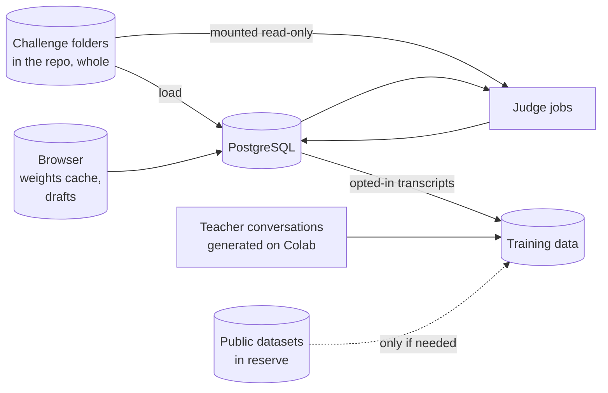
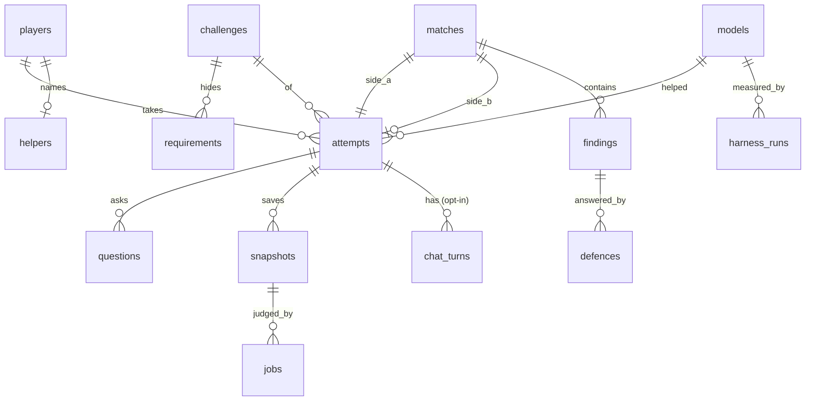

# codevscode - Data model

Nothing here exists yet. Four kinds of data: challenges (files, half of them hidden), the
game's records (PostgreSQL), what the browser keeps, and training data (offline). The shape
matters more than the exact fields.



## Challenge folder

Built at stage 0; `challenges/sample/` is the worked example and `tools/validate.mjs` the
definition of valid. JSON rather than TOML (the first plan), because the browser reads these
files too and has no TOML parser.

```
challenges/<slug>/
  challenge.json        id, version, title, time limit, split (train | held_out), public,
                        the app's file names, checklist weights
  public/
    brief.md            the client's request, vague on purpose
    interface.md        routes, shapes, status codes, the app shape
    starter/            app.js (a scaffold: routing and plumbing done), schema.sql, index.html
    smoke.json          a public walk-through of the routes (sign up, log in, use them); only
                        crashes on it are ever reported, never right or wrong answers
  hidden/
    requirements.json   one entry per hidden requirement (below)
    reference/          the author's app
    tests/              one .js file per category, each exporting a list of tests
    bugs.json           the planted bugs: edits to the reference, and the tests each must fail
    house-findings.js   tests the house files against players, each with a claim
    scripts/            scripted conversations for the harness, one .json each
    questions.json      questions labelled with the requirement they should reveal, or null;
                        what the client's matcher is measured on
    defence.json        stage 9: questions and key points
```

A hidden requirement:

```
{
  "id": "lockout",
  "category": "security",
  "phrasings": ["what about people guessing passwords", "should there be a limit on login attempts", "..."],
  "answer": "Someone tried guessing passwords on our old system. After 5 wrong passwords in a row ...",
  "tests": ["security/lockout-after-five", "security/lockout-ends", "security/lockout-in-a-row"]
}
```

A test with `"requirement": null` is a checklist test: expected of every app whether or not
anyone asked. A planted bug:

```
{
  "id": "search-built-from-text",
  "category": "security",
  "title": "The search pastes the search text into the SQL",
  "edits": [{ "file": "app.js", "find": "<exact text in the reference>", "replace": "<buggy text>" }],
  "fails": ["security/search-injection"]
}
```

An edit's `find` must occur exactly once. The validator applies each bug to the reference and
checks it fails exactly the tests in `fails` - no fewer (the tests would miss it) and no more
(it would break something else too).

Challenges are tracked whole, hidden halves included - the author's decision: "the hidden
halves can live on the portfolio fine. no need to hide it." "Hidden" means the game does not
show it to a player until they earn it, not that it is secret. A held-out challenge is kept out
of training by the data pipeline refusing to read it (stage 8), which is the only guarantee
that ever mattered for our own model.

## Tables



| Table | Key fields | Notes |
| --- | --- | --- |
| `players` | id, email, display_name, created_at, training_consent, suspended_at | Email for sign-in only, never shown to anyone |
| `sign_in_links` | token_hash, player_id or email, expires_at, used_at | roamer's pattern: the link opens a page with a button; scanners cannot sign anyone in |
| `sessions` | id_hash, player_id, expires_at | Secure, HttpOnly, SameSite cookie |
| `helpers` | player_id, name, updated_at | One per player. Name checked against a list |
| `challenges`, `requirements` | - | Not built: challenges stay files in the repo (public, hidden halves included), and attempts refer to them by slug and version. Requirements and their vectors are read from the folder and kept in memory. Tables only if the files stop being enough |
| `models` | id, name, base, method, data_manifest_hash, weights_url, licence, shipped_at | Every model the helper has ever been |
| `attempts` | Built at stage 3 (migration 0003): id (random UUID), challenge (slug), challenge_version, mode (practice, ranked), started_at, submitted_at. Later: player_id (stage 7), model_id, pasted_chars | The clock is server time: started_at to submitted_at. The id is a UUID so it cannot be guessed |
| `questions` | Built at stage 3: id, attempt_id, text, requirement (best match, whatever its score), score, revealed, matcher, asked_at | Every question, revealed or not, for the score card and for measuring the matcher on real questions |
| `snapshots` | id, attempt_id, kind (submission, fix), files (jsonb), created_at | Files are small; size-limited at the API |
| `chat_turns` | id, attempt_id, role, text, created_at | Stored only when the player opted in to training use; otherwise the conversation never leaves the browser |
| `jobs` | id, kind (judge, house), status (queued, running, done, failed), payload (jsonb: challenge slug and files), result (jsonb: verdict, results, seconds, exit code, stderr tail), error, attempts, max_attempts, locked_at, locked_by, created_at, started_at, finished_at | Built at stage 2 (migration 0002). The judge's queue: claimed with FOR UPDATE SKIP LOCKED; `locked_at` read by the reaper; a sandbox failure retries up to max_attempts. Files travel in the payload until stage 5 adds snapshots |
| `matches` | id, challenge_id, attempt_a, attempt_b (null while waiting), opponent_kind (player, house), state, review_ends_at, defence_ends_at, published_at | State: waiting, review, defence, done |
| `findings` | id, match_id, by_attempt, against_attempt, category, claim, test_source, status, reference_result, target_result, filed_at | Status: filed, valid, invalid, fixed, conceded. House findings have by_attempt null |
| `defences` | id, finding_id, kind (fix, concede), snapshot_id, result, created_at | A fix points at its snapshot |
| `review_questions` | id, match_id, by_attempt, text, answer, grade, graded_by_model_id | Stage 9 |
| `scores` | attempt_id, match_id, total, parts (jsonb), computed_at, scoring_version | Recomputable from the rows above; `scoring_version` so a change in weights is visible |
| `harness_runs` | id, model_id, challenge_id, seed, results (jsonb), tokens_per_s, created_at | Held-out challenges only |
| `reports` | id, by_player, target_kind, target_id, reason, resolved_at, action | Moderation |
| `outbox` | id, to, template, payload, status, attempts, sent_at | roamer's outbox and worker |
| `events` | id, player_id, kind, detail, at | An activity log for the author |

## What the browser keeps

| What | Where | Why |
| --- | --- | --- |
| Model weights | Cache Storage, managed by the runtime | Downloaded once, often around a gigabyte; the page says so before starting |
| The open attempt's files and chat | IndexedDB | A refresh mid-build loses nothing. Cleared on submit unless the player keeps it |
| Helper name, editor settings | localStorage | Conveniences; the server holds the real helper name for signed-in players |

Every read and write to browser storage is wrapped so a private window still plays.

## Training data

Every source is a row in a manifest committed with the notebooks: name, link, licence, what
was taken, filters, row count.

**The first model is trained on our own data only** - the author's decision: "lets leave
public datasets unless we need them later". Public datasets come in only if the harness shows
the model needs more than our own data can give, and each one is then a decision of its own.

Used from the first fine-tune:

| Source | What it gives | Notes |
| --- | --- | --- |
| Our challenges, train split | Brief, revealed answers, reference app, the author's scripted conversations | The most on-target data there is, and it grows with every challenge |
| Teacher conversations | A bigger open-weights coding model, run on Colab, plays the player's side with varied messages and the helper's side on our train challenges; a conversation is kept only when the app it ends with passes the hidden tests | The main volume. Generated by us from open weights - no key, no hosted model. Teacher's licence checked for use of its outputs |
| Opted-in player transcripts | Real conversations, with the judged result | After launch only, with consent, and never from held-out challenges |

For the analyzer (A1 to A3), rows written by `tools/mutate.mjs --out`, one JSON object per line
in `codevscode/data/` (generated, not committed):

```
{ "kind": "mutant", "source": "challenge:sample@1", "mutant": "sql-from-text:app.js:142",
  "operator": "sql-from-text", "declared": "security", "file": "app.js", "line": 142,
  "status": "caught", "caught_by": ["correctness/awkward-text"], "labels": ["correctness"],
  "function": "createNote", "before": "<the function>", "code": "<the function, mutated>" }
{ "kind": "clean", "source": "challenge:sample@1", "function": "createNote", "code": "...", "labels": [] }
```

Used for measurement only, never trained on:

| Source | What it gives | Notes |
| --- | --- | --- |
| MBPP, HumanEval (MultiPL-E JavaScript) | Small human-written problems with tests | The general sanity check: the fine-tune must not forget how to code |

In reserve, not used unless needed later (licences to verify if they are):

| Source | What it would give |
| --- | --- |
| CommitPackFT, JavaScript | Commit message plus the change: "make the code do X" |
| BugsJS | Real JavaScript bugs with fixes and tests |
| The Stack v2, JavaScript subset | Real code, permissively licensed |
| CVEfixes | Security fixes from real vulnerabilities, mostly not JavaScript |
| OWASP Juice Shop, NodeGoat | Deliberately insecure Node apps - useful to the author as reading when writing security challenges, whether or not they are ever trained on |

Instruction sets written by hosted models (OSS-Instruct, Code Alpaca, Evol-Instruct) are out,
not in reserve.
