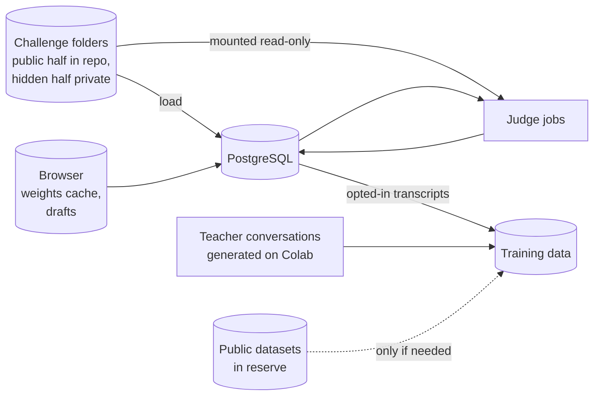
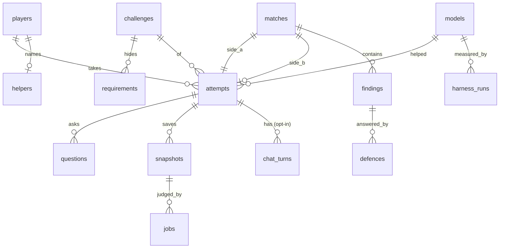

# codevscode - Data model

Nothing here exists yet. Four kinds of data: challenges (files, half of them hidden), the
game's records (PostgreSQL), what the browser keeps, and training data (offline). The shape
matters more than the exact fields.



## Challenge folder

```
challenges/<slug>/
  challenge.toml        id, version, title, time limit, checklist weights, split (train | held_out)
  public/
    brief.md            the client's request
    interface.md        routes, shapes, examples
    starter/            app.js, schema.sql, index.html
  hidden/
    requirements.toml   one entry per hidden requirement (below)
    reference/          the author's app
    tests/              spec/, security/, efficiency/, practicality/
    bugs/               one patch per planted bug, each naming the tests it should fail
    house-findings/     tests the house files against players
    defence.toml        stage 9: questions and key points
    scripts/            scripted conversations for the harness
```

A hidden requirement:

```
[[requirement]]
id = "rate-of-signups"
category = "efficiency"
phrasings = ["how many people will sign up", "what load should it handle", "how big will the list get"]
answer = "We expect about fifty thousand sign-ups in the first week, most of them on launch day."
tests = ["efficiency/bulk-insert", "efficiency/list-page"]
threshold = 0.62
```

`hidden/` is never in the public repo. Only the sample challenge is published whole, marked as
spoilers, as the demo. Where the private halves live - a private repository or the private
root folder - is decided at stage 0.

## Tables



| Table | Key fields | Notes |
| --- | --- | --- |
| `players` | id, email, display_name, created_at, training_consent, suspended_at | Email for sign-in only, never shown to anyone |
| `sign_in_links` | token_hash, player_id or email, expires_at, used_at | roamer's pattern: the link opens a page with a button; scanners cannot sign anyone in |
| `sessions` | id_hash, player_id, expires_at | Secure, HttpOnly, SameSite cookie |
| `helpers` | player_id, name, updated_at | One per player. Name checked against a list |
| `challenges` | id, slug, version, title, time_limit_s, split, weights, retired_at | Loaded from the folder; a new version is a new row so old attempts stay judged against what they saw |
| `requirements` | id, challenge_id, key, category, answer, threshold, phrasing_vectors | Hidden. Vectors computed at load |
| `models` | id, name, base, method, data_manifest_hash, weights_url, licence, shipped_at | Every model the helper has ever been |
| `attempts` | id, player_id (null for practice without sign-in), challenge_id, mode (practice, ranked), model_id, started_at, submitted_at, hand_edit_chars, pasted_chars, status | The clock is server time: started_at to submitted_at |
| `questions` | id, attempt_id, text, best_requirement_id, similarity, revealed, asked_at | Every question, revealed or not, for the score card and for measuring the matcher |
| `snapshots` | id, attempt_id, kind (submission, fix), files (jsonb), created_at | Files are small; size-limited at the API |
| `chat_turns` | id, attempt_id, role, text, created_at | Stored only when the player opted in to training use; otherwise the conversation never leaves the browser |
| `jobs` | id, kind, snapshot_id, finding_id, status, attempts, locked_at, started_at, finished_at, result (jsonb), error | The judge queue. `locked_at` is read by the reaper; retries up to three |
| `matches` | id, challenge_id, attempt_a, attempt_b (null while waiting), opponent_kind (player, house), state, review_ends_at, defence_ends_at, published_at | State: waiting, review, defence, done |
| `findings` | id, match_id, by_attempt, against_attempt, category, claim, test_source, status, reference_result, target_result, filed_at | Status: filed, valid, invalid, fixed, conceded. House findings have by_attempt null |
| `defences` | id, finding_id, kind (fix, concede), snapshot_id, result, created_at | A fix points at its snapshot |
| `review_questions` | id, match_id, by_attempt, text, answer, grade, graded_by_model_id | Stage 9 |
| `scores` | attempt_id, match_id, total, parts (jsonb), computed_at, scoring_version | Recomputable from the rows above; `scoring_version` so a change in weights is visible |
| `harness_runs` | id, model_id, challenge_id, seed, results (jsonb), tokens_per_s, created_at | Held-out challenges only |
| `reports` | id, by_player, target_kind, target_id, reason, resolved_at, action | Moderation |
| `outbox` | id, to, template, payload, status, attempts, sent_at | roamer's outbox and worker |
| `events` | id, player_id, kind, detail, at | An activity log for the author |

## What the browser keeps

| What | Where | Why |
| --- | --- | --- |
| Model weights | Cache Storage, managed by the runtime | Downloaded once, often around a gigabyte; the page says so before starting |
| The open attempt's files and chat | IndexedDB | A refresh mid-build loses nothing. Cleared on submit unless the player keeps it |
| Helper name, editor settings | localStorage | Conveniences; the server holds the real helper name for signed-in players |

Every read and write to browser storage is wrapped so a private window still plays.

## Training data

Every source is a row in a manifest committed with the notebooks: name, link, licence, what
was taken, filters, row count.

**The first model is trained on our own data only** - the author's decision: "lets leave
public datasets unless we need them later". Public datasets come in only if the harness shows
the model needs more than our own data can give, and each one is then a decision of its own.

Used from the first fine-tune:

| Source | What it gives | Notes |
| --- | --- | --- |
| Our challenges, train split | Brief, revealed answers, reference app, the author's scripted conversations | The most on-target data there is, and it grows with every challenge |
| Teacher conversations | A bigger open-weights coding model, run on Colab, plays the player's side with varied messages and the helper's side on our train challenges; a conversation is kept only when the app it ends with passes the hidden tests | The main volume. Generated by us from open weights - no key, no hosted model. Teacher's licence checked for use of its outputs |
| Opted-in player transcripts | Real conversations, with the judged result | After launch only, with consent, and never from held-out challenges |

Used for measurement only, never trained on:

| Source | What it gives | Notes |
| --- | --- | --- |
| MBPP, HumanEval (MultiPL-E JavaScript) | Small human-written problems with tests | The general sanity check: the fine-tune must not forget how to code |

In reserve, not used unless needed later (licences to verify if they are):

| Source | What it would give |
| --- | --- |
| CommitPackFT, JavaScript | Commit message plus the change: "make the code do X" |
| BugsJS | Real JavaScript bugs with fixes and tests |
| The Stack v2, JavaScript subset | Real code, permissively licensed |
| CVEfixes | Security fixes from real vulnerabilities, mostly not JavaScript |
| OWASP Juice Shop, NodeGoat | Deliberately insecure Node apps - useful to the author as reading when writing security challenges, whether or not they are ever trained on |

Instruction sets written by hosted models (OSS-Instruct, Code Alpaca, Evol-Instruct) are out,
not in reserve.
