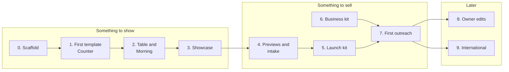

# resto-dir - Build plan

## Objective

**Restaurant websites good enough to sell.** A set of templates a restaurant can choose
from, a tool that turns one restaurant's details into a finished site in any of them, and
the material to find restaurants, show them what they would get, and look after them once
they pay.

It is a freelance business first and a portfolio project second. The templates and the tool
are public and show the engineering; the clients and the money are private.

Finished, for the first version, when six things are true:

1. Three templates exist, each filled in with a made-up restaurant, each passing the
   accessibility, speed and phone-width checks in 03-architecture.
2. The same restaurant's content file renders correctly in all three templates without
   being changed.
3. "Open now" is right for hours that cross midnight, split days, holiday exceptions and a
   daylight saving change, and a test proves each one.
4. A showcase page shows every template, and a prospect can open it on their phone.
5. The author can go from a real restaurant's public menu to a labelled, unindexed preview
   link in under an hour.
6. One real restaurant is live on its own domain - paying, or the first client at an
   agreed discount in exchange for being the example.

There are no dates in this plan. Stages are ordered by what each one needs from the one
before it.

## Order of work

| Stage | What it delivers |
| --- | --- |
| 0. Scaffold | The content file schema, one made-up restaurant, the build tool rendering one bare page, the hours logic with its tests, all run from PowerShell |
| 1. First template | Counter, complete: home, menu, notices, open now, structured data, photos, passing every check |
| 2. Two more templates | Table and Morning, from the same content file, plus two more made-up restaurants that suit them |
| 3. Showcase | One page showing each template with each sample, with a switch to see the same restaurant in another template. The link that goes in every outreach email |
| 4. Previews and intake | Preview mode (bar, noindex), an intake checklist, and a report of what is missing from a half-filled content file |
| 5. Launch kit | Publishing a client to Cloudflare Pages on their domain, written up as a checklist and checked once end to end on a test domain |
| 6. Business kit | Price list, contract, invoice method, outreach emails, the private tracker. Not code; can run alongside stages 1 to 5 |
| 7. First outreach | A first batch of Kansas City restaurants contacted, with previews, and what came back written down |
| 8. Owner edits | A way for a client to change hours, notices and prices without the author. Only if clients ask for it |
| 9. International | Languages beyond English, address and price formats, and outreach rules for the countries chosen |

### Why one template is finished before the next is started

The first template is where the content file is proven. Every field that turns out to be
missing or wrong is cheapest to fix while one template reads it. Building three at once
means fixing each mistake three times.

### Why the showcase comes before previews

A prospect who opens a preview of their own restaurant will want to see the other options.
The showcase is also the safe thing to send when a preview of their own is not appropriate,
and it is the portfolio piece.

### Why owner self-editing waits

The first clients will send changes by text message whatever tool exists. A care plan where
the author makes changes is also the recurring income. A self-edit tool built before anyone
asks for it is a login, a permissions model and a way for a client to break their own site.

## Decisions settled by the author

| Decision | Source |
| --- | --- |
| The project is called resto-dir | Brief, 2026-10-23 |
| It is the author's freelance business: website templates sold to restaurants for a fee | Brief |
| The alternative being offered is to Squarespace and other site builders | Brief |
| Several templates, sent around to prospects | Brief |
| Customers are found by cold contact, in Kansas City and internationally | Brief |
| No hosted language model API key, ever | Repository rule |
| The author commits; work is left in the tree with a commit title | Repository rule |
| No emoji, ASCII only, Mermaid diagrams, no dates in plans | Repository rule |
| 06-context.md is private and never committed | Repository rule |

## Decisions proposed, waiting for the author's confirmation

| # | Proposal | Instead of |
| --- | --- | --- |
| P1 | Every template reads the same content file, so one restaurant can be shown in any template | A content format per template |
| P2 | Client sites are static files with no server or database | A small app per client |
| P3 | Build tool in Python and Jinja2 | Astro or Eleventy (Node) |
| P4 | Hand-written CSS per template, colours and fonts as custom properties | Tailwind from its CDN |
| P5 | The content file is YAML, checked against a schema | JSON; a database |
| P6 | The menu is always text on the page, never only a PDF | Linking the restaurant's PDF |
| P7 | The site links to ordering, booking and delivery services; it never takes payment | Built-in ordering |
| P8 | Hosting on Cloudflare Pages, one project per client, free tier | GitHub Pages; the portfolio server |
| P9 | The restaurant owns its domain in its own name | The author registering it for them |
| P10 | Templates and made-up samples public here; client content in a private repository | Everything in this repository |
| P11 | Previews for prospects: public information, `noindex`, a preview bar on every page, deleted on a no | Sending only the showcase; previews that look like the real site |
| P12 | Changes are made by the author under a care plan; self-editing is stage 8 | A client editor from the start |
| P13 | Accessibility target WCAG 2.1 AA, checked on every page; contracts promise the target and the checks, not legal compliance | No stated target |
| P14 | Three starting templates: Counter, Table, Morning | Another split |
| P15 | Visit counts with Cloudflare Web Analytics, no cookies | Google Analytics |
| P16 | Fonts and maps with no live third-party requests | Google Fonts and a Google Maps embed |
| P17 | Kansas City first; international after the first clients, with language and currency in the content file from day one | Both at once |
| P18 | Sample restaurants are made up, never real ones | Real Kansas City restaurants as samples |

## Open questions

The ones that change what gets built first:

1. **What does "dir" stand for?** If it means a directory - a public listing of Kansas City
   restaurants that doubles as a way to find prospects and show off templates - that is a
   second product and changes stage 3. If it is just the folder name, nothing changes.
2. **How it is priced.** A one-time build fee, a monthly care plan, or both. What a care plan
   includes (how many changes a month, Google Business Profile upkeep, photos). The price
   decides how much time each client can be given.
3. **The restaurant's own photos and logo in a cold preview.** Using them makes the preview
   convincing; it is also their copyrighted material used without asking. The alternative is
   the template's stock imagery with their name set in type.
4. **Who designs the templates' look.** The author, from references; the resume's Claude
   Design system; or the build proposes designs for the author to pick from.
5. **Ordering widgets.** Plain links out, or embedding Toast's or Square's ordering inside the
   page where the restaurant's provider allows it.
6. **How expired notices come down.** A daily rebuild per client, or the browser hiding a
   notice past its end date. The second needs no schedule; the first keeps the page honest
   without JavaScript.
7. **International: where first.** Which countries and languages, and whether outreach there
   is cold email at all (see Risks).
8. **The business side.** Sole proprietor or an LLC; whether Kansas City, Missouri needs a
   business licence for this; how invoices are sent and paid.
9. **Is resto-dir shown on moabboud.dev**, and does the showcase live there.

## Risks

| Risk | What reduces it |
| --- | --- |
| Restaurants already get a free site with their point-of-sale (Square, Toast) and see no reason to pay | Sell what those lack: a real menu, a look of their own, speed, and a local person who makes the changes. Check what those free sites currently include before pricing |
| Cold email is mostly ignored | Lead with their own preview, not a pitch. Short emails, one follow-up. Walk-ins and phone calls in Kansas City may convert better; stage 7 records which |
| Cold email law differs by country. The US (CAN-SPAM) allows it with an honest sender, a physical address and a working opt-out; Canada (CASL) needs some form of consent; the UK and EU are stricter for sole traders and partnerships | Kansas City first. Before emailing any other country, write down that country's rule in stage 9 |
| A preview using a real restaurant's name is mistaken for their site, or annoys them | The preview bar, `noindex`, the author's own address, deletion on request (P11) |
| Accessibility lawsuits against small business websites are common in the US | P13: build to AA, run the checks, keep the reports, do not promise legal compliance |
| Every client adds upkeep: holiday hours, price rises, new menus | Changes are one file. Price the care plan for it. Cap clients to what one person can look after |
| A client wants to leave and expects to lose everything | P9 and the hand-over in J3: they own the domain and get the files. Saying so up front is a selling point |
| The free tier of the host changes its terms | Sites are plain files; moving host is a re-publish, not a rebuild |
| Templates look generic | A template is a full design for a kind of restaurant, not a colour swap. Three good ones beat ten thin ones |
