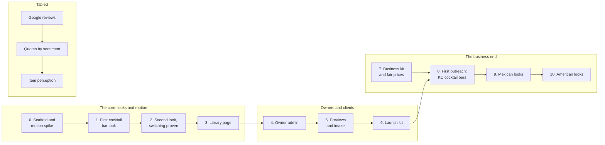

# Menu Factory - Build plan

"Menu Factory" is a working name. See README for how the name is kept in one place.

## Objective

**Win your customers over before they even show up.** A library of restaurant and bar
websites that are all about flash - motion, digital art, atmosphere - so a guest wants to go
before they arrive. Each venue gets the look that fits its identity, an elevated design
without an agency's fee, a simple admin to keep its content current, and on the monthly plan
the freedom to switch to another look. Tired of your basic site? Switch up the look.

**The core comes first.** The animations and the idea working, then the business end:
Google reviews, prices and the rest wait until the looks prove themselves (author,
2026-10-23).

It is a freelance business first and a portfolio project second.

Finished, for the first version, when six things are true:

1. At least two cocktail bar looks are in the library, each with a full show and a designed
   calm version, passing every check in 03-architecture in both.
2. One venue's content renders correctly in every look without being changed, so a switch
   is one value.
3. "Open now" and happy hour are right for late nights past midnight, split days, holiday
   exceptions and a daylight saving change, and a test proves each one.
4. The library page shows every look and works on a phone.
5. A non-technical owner can change a price, mark a drink sold out and add an event from a
   phone, preview it, publish it, and undo it, without help.
6. One real venue is live on its own domain.

There are no dates in this plan. Stages are ordered by what each one needs from the one
before it.

## Order of work

| Stage | What it delivers |
| --- | --- |
| 0. Scaffold and motion spike | The TypeScript and Astro project, the brand file and its test, the content schema, a made-up cocktail bar, hours and happy hour logic with tests, the less/more motion control, and **one real Claude Design export taken all the way to a rendered page in both motion levels** |
| 1. First cocktail bar look | The author's first design, built into a complete look: home, menu, events, open now, happy hour, structured data, full and calm versions, every check passing |
| 2. Second look, switching proven | A second cocktail bar look. The same bar in both, changing only the look's name. A second made-up bar to prove the looks are not tuned to one venue |
| 3. Library page | Every look with every sample, filter by kind of place |
| 4. Owner admin | The admin on the server: owner logins, the short screens, drafts, preview, publish, undo, uploads, look requests. Starts with a spike measuring whether Payload fits on the server |
| 5. Previews and intake | Preview mode, the intake checklist, setting up a new venue in the admin |
| 6. Launch kit | Publishing to Cloudflare Pages on a venue's domain, end to end on a test domain |
| 7. Business kit and fair prices | Research into what is fair to charge for designed template sites, then plans, contract, invoicing, outreach emails, the private tracker. Not code; can run alongside stages 1 to 6 |
| 8. First outreach | Kansas City cocktail bars contacted with previews |
| 9. Mexican looks | Looks and a made-up sample |
| 10. American looks | Looks and a made-up sample |
| Tabled | Google reviews; quotes chosen by the owner, marked good, mixed or bad; an admin view of how each menu item is perceived. Picked up when the author is ready |

### Why the motion spike is in stage 0

The author's first question is whether the animations can be made to work. A real Claude
Design export, carried through to a page with real venue content in both motion levels,
answers it before anything else is built on top. It also sets the weight budgets with real
numbers instead of guesses.

### Why two cocktail bar looks before the library

The monthly plan sells switching. With one look per kind of place there is nothing to switch
to, and two looks prove the content is not quietly shaped around the first design.

### Why the admin comes after the library, and before any client

The looks are the product and the author's focus; they are proven first, against sample
files. But no client can be signed without the admin, because owners will change their own
content. Since looks read the content through one schema, moving from files to the admin's
database later costs the looks nothing.

## Decisions settled by the author

| Decision | Source |
| --- | --- |
| A freelance business selling restaurant website designs, cold-contacting venues in Kansas City and internationally | Brief, 2026-10-23 |
| "Menu Factory" is a working name; the name must be easy to switch | 2026-10-23 |
| The purpose is identity: an elevated look without the large fee | 2026-10-23 |
| "Win your customers over before they even show up" - it is all about flash | 2026-10-23 |
| A library venues browse and choose from | 2026-10-23 |
| Two plans: one-time, and monthly so a venue can alternate looks | 2026-10-23 |
| Every look reads the same content (was P1) | Follows from the plans |
| Venues' own photos and logos, in previews too | 2026-10-23 |
| The author designs the looks and the motion, with Claude Design; this design may propose looks | 2026-10-23 |
| No online ordering and no third-party ordering services. The site stands on its own | 2026-10-23 |
| Library order: cocktail bars, then Mexican, then American | 2026-10-23 |
| Less motion and more motion, on every site | 2026-10-23 |
| Owners get a simple admin to control their site's content, not its art. Must suit owners who are not technical | 2026-10-23 |
| The language is whatever is friendliest for animation and digital art | 2026-10-23 - TypeScript proposed as the answer (P3) |
| Animations and the core idea first; Google reviews and Business Profile work tabled until then | 2026-10-23 |
| Prices come after research into what is fair for template sites | 2026-10-23 |
| Reviews, when built: quotes marked good, mixed or bad, shown at the venue's discretion, plus an owner-facing view of how items are perceived online | 2026-10-23 |
| No hosted language model API key, ever | Repository rule |
| The author commits; work is left in the tree with a commit title | Repository rule |
| No emoji, ASCII only, Mermaid diagrams, no dates in plans; 06-context.md is never committed | Repository rule |

## Decisions proposed, waiting for the author's confirmation

Numbers are kept stable so answers can refer to them. Revised and retired ones say why.

| # | Proposal | Instead of |
| --- | --- | --- |
| P1 | Settled - see above | |
| P2 | Revised: guests get built files on a static host; owners edit in an app on the server; Publish rebuilds the files (03-architecture, "Static or not") | All static with no admin; every site rendered live by the server |
| P3 | Revised: TypeScript throughout, Astro for the sites, React inside Astro where a design needs it | Python and Jinja (the earlier proposal); Next.js; SvelteKit |
| P4 | Revised: GSAP for timeline and scroll motion, Three.js for 3D, Lottie and Rive for designer-made animation, all served with the site | Tailwind from a CDN; one motion library per look |
| P5 | Revised: a Zod schema; YAML files for samples and before the admin exists; the admin's database after | A database from the start |
| P6 | The menu is always text on the page, never only a PDF | Linking the venue's PDF |
| P7 | Retired - ordering ruled out by the author | |
| P8 | Public sites on Cloudflare Pages, one project per venue, free tier | GitHub Pages; serving them from the server |
| P9 | The venue owns its domain in its own name | The author registering it |
| P10 | Code and made-up samples public here; client content, accounts and credentials private | Everything in this repository |
| P11 | Previews: `noindex`, a preview bar on every page, deleted on a no | Previews that look like the real site |
| P12 | Retired - replaced by the owner admin the author asked for | |
| P13 | WCAG 2.1 AA, checked in both motion levels; contracts promise the target and the checks, not legal compliance | No stated target |
| P14 | Retired - replaced by the author's order | |
| P15 | Visit counts with Cloudflare Web Analytics, no cookies | Google Analytics; nothing |
| P16 | Fonts and maps with no live third-party requests | Google Fonts; a Maps embed |
| P17 | Kansas City first; language and currency in the content from day one | Both at once |
| P18 | Sample venues in the library are made up | Real venues as samples |
| P19 | Tabled - reviews via the Business Profile API | |
| P20 | Revised: Publish rebuilds a venue; a daily build also drops expired notices and events | Rebuild only on change |
| P21 | At least two cocktail bar looks before the first outreach | Outreach with one |
| P22 | Revised: content first, the show around it; heavy art loads late and only in more-motion; a weight budget per look set after the spike | Trimming the art for speed |
| P23 | Superseded by the author's review design (quotes by sentiment, item perception) - tabled | |
| P24 | The product name lives only in the brand file; a test fails if it appears elsewhere | Find-and-replace at rename time |
| P25 | Tabled with reviews | |
| P26 | Plain links to the venue's social profiles are kept | No outside links at all |
| P27 | Owner admin on Payload CMS, cut down for non-technical owners, if the stage 4 spike shows it fits the server; a small hand-built admin if not | A hand-built admin from the start; a hosted CMS |
| P28 | The admin and its database run on the existing server as a compose profile; public sites never depend on it | A second server |
| P29 | Every owner change is a draft; preview, publish, and undo to any earlier version | Changes going live on save |
| P30 | Owners see their content in other looks and ask to switch; the author approves | Owners switching looks themselves |
| P31 | The motion control is always visible, starts from the device setting, and remembers the guest's choice in their browser only | Following the device setting only, with no control |
| P32 | Tabled: review sentiment judged by a word-list baseline then the author's own trained model, never a hosted one | |
| P33 | Tests: Vitest, Playwright in both motion levels, axe-core, Lighthouse | |

## Open questions

1. **P2 - static or not.** The author is unsure. The proposal is the split above: files for
   guests, an app for owners.
2. **P27 - which admin.** Payload, or a hand-built one. Decided by the stage 4 spike.
3. **P30 - may owners switch looks themselves**, or only ask.
4. **How owners log in** - a password, or a link emailed to them (needs a mail relay).
5. **How many cocktail bar looks before outreach** - two (P21) or more.
6. **P26 - social links**, kept or not.
7. **The first venue** - a real bar at a discount, in return for being the example.
8. **The business side** - sole proprietor or LLC, a Kansas City licence, invoicing.
9. **Where the library lives** - moabboud.dev or its own domain under the final name.

## Tabled questions

Picked up when the author is ready, not before.

- Prices for both plans, switches per month, what happens when a monthly client cancels -
  after the fair-price research in stage 7.
- Google reviews: which API, a Business Profile for Menu Factory, Google's approval.
- Whether reviews appear as a section, beside the items they mention, or both.

## Ideas, not yet scheduled

### The layer: motion on top of a site the venue already has

The author's idea (2026-10-24): a package sent as one file, or one line to paste, that loads
on a venue's existing website and draws an upper layer of visual elements over it - no new
site, no server, no domain move.

**It is a separate, independent product** (author, 2026-10-24). It does not replace or change
the main product: Menu Factory is still the library site showcasing full sites, and
everything else in this plan stands. The layer is sold on its own, to venues who want to keep
the site they have. The two may share code - the motion engine, the less/more control - but
neither depends on the other being sold.

It needs nothing on the venue's server. It is one line added to their website's pages, which
their site builder or web host lets them paste in; the file itself is served from the
author's static host.

**It is possible, and the mechanism is common.** Chat widgets, analytics and WebGL effect
tools such as Unicorn Studio all work by a pasted script. A layer would be:

- One line pasted into the site, `<script src="https://<layer host>/<venue>.js" defer>`,
  loading one file from a static host.
- A full-page layer above the site that never takes clicks (`pointer-events: none`), drawn in
  canvas or WebGL, inside a shadow root so its styles and the site's cannot collide.
- The same motion engine, art and less/more motion control as the looks.

**Two kinds of effect, with different risk:**

| Kind | Examples | Risk |
| --- | --- | --- |
| Ambient - ignores the site's layout | An opening reveal, smoke or light drifting across the page, particles, a cursor trail, art in the margins, a seasonal scene | Low. Works on any site |
| Anchored - attached to parts of the site | Steam over the menu heading, a glow behind the logo | High. Found by the site's own element names, so it breaks silently when the venue edits their site |

**The limits, stated plainly:**

- **The venue's site builder decides.** The layer needs a place to paste a script into the
  whole page. Squarespace allows it on its middle and upper plans, not its entry plan
  (2025 guides). WordPress allows it. Some builders only allow code inside a boxed embed,
  which cannot draw over the rest of the page; there the layer does not work. Wix, Square
  Online, Toast's sites and GoDaddy's builder still need checking one by one.
- **It must not hurt their site.** It loads after their content, stays within a weight
  budget, pauses when the tab is hidden, and gives way completely on less motion.
- **It covers their content only as art, never as a wall.** Text under it stays readable.
- **It is code running on someone else's site.** No tracking, no network calls beyond its own
  file, and a contract that says what it does.

**Why it is worth having alongside the main product:**

- It reaches venues the full sites cannot: "keep your site, add the show". No migration, so
  an easier yes.
- Hosted by the author, so changing a layer's look is a change on the author's side, with
  nothing for the venue to do. If a paying venue stops paying, the layer can be turned off.
- It can reuse the motion work done for the looks, so it costs less to build than starting
  from nothing.
- A venue that starts with a layer may later want a full site, but the layer is not designed
  as a step towards one. It has its own plans and prices, tabled with the rest.

**For outreach**, a recording of the venue's own current site with the layer playing over it
is the safest preview; loading their site inside the author's page is often blocked by the
site itself.

Not scheduled, and not part of the main stage order. If the author wants it built, it runs
as its own track once stage 1 exists, since that is when the motion engine and the less/more
control are there to reuse. It needs no admin. It may get its own folder and requirements
when it starts.

## Risks

| Risk | What reduces it |
| --- | --- |
| Flash makes pages slow on phones | Content first, the show around it (P22); heavy pieces late and only in more-motion; weight budgets |
| Flash makes some guests ill or locks out screen reader users | The less-motion level designed per look; the device setting respected; checks in both levels |
| Claude Design exports are hard to turn into looks | The stage 0 spike, on a real export, before anything else |
| The admin is the first real attack surface: logins, uploads | Payload's tested auth; one venue per owner; image-only, size-limited uploads; no design fields |
| Payload is too heavy for the shared server | Measured in the stage 4 spike; the hand-built fallback |
| The server goes down | Public sites are files on another host; only editing pauses |
| A prospect objects to their photos and logo in a preview | Unindexed, labelled, under the author's domain, deleted on request |
| Commercial use of Claude Design output | Check Claude Design's terms before the first sale |
| GSAP's licence | Free for commercial use; its one restriction is on visual animation builders, which the admin is not |
| Cold email law differs by country | Kansas City first; each country's rule written down before emailing there |
| Accessibility lawsuits against small US business sites | P13, checked on every look in both motion levels |
| A look only works with its own sample text | Every look rendered with every sample, including a long menu and missing photos |
| Moving from Python habits to TypeScript | One language for the whole project; the repository's Python projects are unaffected |
