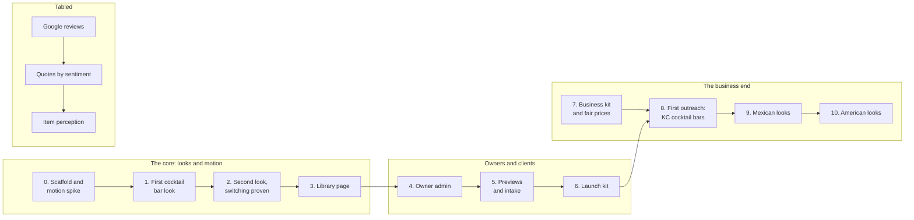

# Menu Factory - Build plan

"Menu Factory" is a working name. See README for how the name is kept in one place.

## Objective

**Win your customers over before they even show up.** A library of restaurant and bar
websites that are all about flash - motion, digital art, atmosphere - so a guest wants to go
before they arrive. Each venue gets the look that fits its identity, an elevated design
without an agency's fee, a simple admin to keep its content current, and on the monthly plan
the freedom to switch to another look. Tired of your basic site? Switch up the look.

**It also answers five problems the whole industry has** (author, 2026-10-26). They are goals
alongside the look, not instead of it:

| Problem | Evidence the author gathered | What Menu Factory does about it | Where |
| --- | --- | --- | --- |
| A bad site turns guests away | A 2019 US survey: 77% of diners check a restaurant's website before going, and 68% have been put off by one - hard navigation 33%, hard-to-read menus 30%, a dated look 30%. 36% skipped ordering because the site did not work on a phone | A designed look (the dated look); the menu as large, real text with section links (the hard-to-read menu); everything a guest came for within one tap of the top (the navigation); every page checked at phone width (the phone) | The looks; P44, P45 |
| Wrong hours online | A Yext survey: 44% went to a closed business in the past year because the hours online were wrong | Open now worked out live, holiday exceptions, owners change hours themselves; the same hours written for search engines and maps; a check at launch, and monthly after, that the Google Business Profile says the same | `shared/hours.js` (built); P42; stage 6 |
| Invisible to AI search | 22% of diners have used ChatGPT or Gemini to pick a restaurant, but only 39% of operators have updated their listings for it; a 2026 study found 83% of restaurant locations never appear in AI answers. AI tools can read a text menu, not a photo of one | The menu, hours and address written into the page itself as plain text and structured data, so assistants and crawlers that do not run JavaScript can read them | P41, P42 |
| Delivery fees | DoorDash and Uber Eats take 20-30% of each order; Uber Eats raised its fees in March 2026 | No online ordering yet. A "Call to order" button at the top of every page for venues that take phone orders: the order goes straight to the restaurant with no commission | P43 |
| Missed calls | An estimated 40% of reservation calls go unanswered | Not solved yet - and a site that pushes guests to call makes it worse. Open question 9 | Open |

The numbers are the author's research. Each needs its source linked before it appears in
anything public - the overview, the library, an outreach email.

**The core comes first.** The animations and the idea working, then the business end:
Google reviews, prices and the rest wait until the looks prove themselves (author,
2026-10-23).

It is a freelance business first and a portfolio project second.

**It runs on GitHub Pages** (author, 2026-10-25): plain files, no server, no build step, the
same way the rest of the portfolio is published. See 03-architecture, "The constraint".

Finished, for the first version, when seven things are true:

1. At least two cocktail bar looks are in the library, each with a full show and a designed
   calm version, passing every check in 03-architecture in both.
2. One venue's content renders correctly in every look without being changed, so a switch
   is one value.
3. "Open now" and happy hour are right for late nights past midnight, split days, holiday
   exceptions and a daylight saving change, and a test proves each one.
4. The library page shows every look and works on a phone.
5. A non-technical owner can change a price, mark a drink sold out and add an event from a
   phone, preview it, publish it, and undo it, without help.
6. A venue's menu, hours and address can be read from its page with JavaScript turned off,
   and its structured data - menu and holiday hours included - validates.
7. One real venue is live on its own domain.

There are no dates in this plan. Stages are ordered by what each one needs from the one
before it.

## Order of work

| Stage | What it delivers |
| --- | --- |
| 0. Scaffold and motion spike | The plain-files project; the brand file and its test; the venue JSON schema; a made-up cocktail bar; hours and happy hour logic with tests; the motion button; and **one real Claude Design export taken all the way to a page with venue content in both motion levels** |
| 1. First cocktail bar look | The author's first design, built into a complete look: home, menu, events, open now, happy hour, structured data, full and calm versions, every check passing |
| 2. Second look, switching proven | A second cocktail bar look. The same bar in both, changing only the look's name. A second made-up bar to prove the looks are not tuned to one venue |
| 3. Library page | Every look with every sample, filter by kind of place |
| 4. Owner admin | A git-based admin page on Pages: sign-in, the short screens, saving as a commit, restoring an earlier version, uploads, look requests. Starts with a spike: can a non-technical person sign in and save with Sveltia CMS |
| 5. Previews and intake | Preview mode, the intake checklist, setting up a new venue |
| 6. Launch kit | A venue's own repository and Pages site on its own domain (or Cloudflare Pages, see open questions), end to end on a test domain |
| 7. Business kit and fair prices | Research into what is fair to charge for designed template sites, then plans, contract, invoicing, outreach emails, the private tracker. Not code; can run alongside stages 1 to 6 |
| 8. First outreach | Kansas City cocktail bars contacted with previews |
| 9. Mexican looks | Looks and a made-up sample |
| 10. American looks | Looks and a made-up sample |
| Tabled | Google reviews; quotes chosen by the owner, marked good, mixed or bad; an admin view of how each menu item is perceived. Picked up when the author is ready |

### Why the motion spike is in stage 0

The author's first question is whether the animations can be made to work. A real Claude
Design export, carried through to a page with real venue content in both motion levels,
answers it before anything else is built on top. It also sets the weight budgets with real
numbers instead of guesses.

### Why two cocktail bar looks before the library

The monthly plan sells switching. With one look per kind of place there is nothing to switch
to, and two looks prove the content is not quietly shaped around the first design.

### Why the admin comes after the library, and before any client

The looks are the product and the author's focus; they are proven first, against sample
files. But no client can be signed without the admin, because owners will change their own
content. The admin writes the same venue JSON files the samples use, so adding it later costs
the looks nothing.

## Decisions settled by the author

| Decision | Source |
| --- | --- |
| A freelance business selling restaurant website designs, cold-contacting venues in Kansas City and internationally | Brief, 2026-10-23 |
| "Menu Factory" is a working name and is not final; the name must be easy to switch | 2026-10-23, restated 2026-10-25 |
| Everything runs on GitHub Pages | 2026-10-25 |
| The tools: plain HTML, CSS and JavaScript modules with no build; GSAP, Three.js, lottie-web and Rive pinned in `shared/lib/`; one JSON file per venue (were P3 to P5) | 2026-10-25 |
| Each look's readable source in a private repository; only an obfuscated copy is published (was P36) | 2026-10-25 |
| The purpose is identity: an elevated look without the large fee | 2026-10-23 |
| "Win your customers over before they even show up" - it is all about flash | 2026-10-23 |
| A library venues browse and choose from | 2026-10-23 |
| Two plans: one-time, and monthly so a venue can alternate looks | 2026-10-23 |
| Every look reads the same content (was P1) | Follows from the plans |
| Venues' own photos and logos, in previews too | 2026-10-23 |
| The author designs the looks and the motion, with Claude Design; this design may propose looks | 2026-10-23 |
| No online ordering for now - guests order by calling in. No third-party ordering services. The site stands on its own | 2026-10-23; "not yet" and calling in, 2026-10-26 |
| The five industry problems - bad sites, wrong hours, invisible to AI search, delivery fees, missed calls - are goals alongside the look | 2026-10-26 |
| Library order: cocktail bars, then Mexican, then American | 2026-10-23 |
| Designs are filed by category: cocktail bar, bar, restaurant, and more as the library grows | 2026-10-25 |
| The designs are kept out of public source control and made as hard to copy as is practical | 2026-10-25 |
| Less motion and more motion, as a visible button on every page (was P31) | 2026-10-23, button settled 2026-10-25 |
| Owners ask for a new look and the author approves it (was P30) | 2026-10-25 |
| Owners get a simple admin to control their site's content, not its art. Must suit owners who are not technical | 2026-10-23 |
| The language is whatever is friendliest for animation and digital art | 2026-10-23 - plain JavaScript proposed as the answer under the Pages constraint (P3) |
| Animations and the core idea first; Google reviews and Business Profile work tabled until then | 2026-10-23 |
| Prices come after research into what is fair for template sites | 2026-10-23 |
| Reviews, when built: quotes marked good, mixed or bad, shown at the venue's discretion, plus an owner-facing view of how items are perceived online | 2026-10-23 |
| No hosted language model API key, ever | Repository rule |
| The author commits; work is left in the tree with a commit title | Repository rule |
| No emoji, ASCII only, Mermaid diagrams, no dates in plans; 06-context.md is never committed | Repository rule |

## Decisions proposed, waiting for the author's confirmation

Numbers are kept stable so answers can refer to them. Revised and retired ones say why.

| # | Proposal | Instead of |
| --- | --- | --- |
| P1 | Settled - see above | |
| P2 | Revised again for Pages: everything is plain files; the owner admin saves by committing to the repository | The server-side admin of the previous draft |
| P3 | Settled - see above. Astro stays the upgrade path | |
| P4 | Settled - see above | |
| P5 | Settled - see above | |
| P6 | The menu is always text on the page, never only a PDF | Linking the venue's PDF |
| P7 | Retired - ordering ruled out by the author | |
| P8 | Revised for Pages: the showcase, samples and previews on the portfolio's GitHub Pages; each paying venue its own repository and Pages site, or Cloudflare Pages if GitHub's terms rule it out (open question) | Cloudflare Pages for everything (previous draft) |
| P9 | The venue owns its domain in its own name | The author registering it |
| P10 | Revised: code and made-up samples public here; a venue's site content is public anyway, so its repository may be public; business records (prices, contracts, prospects) always private | All client content private (previous draft) - a private repository cannot use free Pages |
| P11 | Previews: `noindex`, a preview bar on every page, deleted on a no | Previews that look like the real site |
| P12 | Retired - replaced by the owner admin the author asked for | |
| P13 | WCAG 2.1 AA, checked in both motion levels; contracts promise the target and the checks, not legal compliance | No stated target |
| P14 | Retired - replaced by the author's order | |
| P15 | Visit counts with Cloudflare Web Analytics, no cookies | Google Analytics; nothing |
| P16 | Fonts and maps with no live third-party requests | Google Fonts; a Maps embed |
| P17 | Kansas City first; language and currency in the content from day one | Both at once |
| P18 | Sample venues in the library are made up | Real venues as samples |
| P19 | Tabled - reviews via the Business Profile API | |
| P20 | Revised for Pages: a save republishes through the publish workflow; expired notices and events are hidden by the page itself, so no daily job | A scheduled daily rebuild |
| P21 | At least two cocktail bar looks before the first outreach | Outreach with one |
| P22 | Revised: content first, the show around it; heavy art loads late and only in more-motion; a weight budget per look set after the spike | Trimming the art for speed |
| P23 | Superseded by the author's review design (quotes by sentiment, item perception) - tabled | |
| P24 | The product name lives only in the brand file; a test fails if it appears elsewhere | Find-and-replace at rename time |
| P25 | Tabled with reviews | |
| P26 | Plain links to the venue's social profiles are kept | No outside links at all |
| P27 | Revised for Pages: a git-based admin page (Sveltia CMS leading), decided by a stage 4 spike; owners sign in with a GitHub account | Payload on the server (previous draft) - Pages has no server; Decap CMS; a Google Sheet |
| P28 | Retired - there is no server | |
| P29 | Revised: every save is a commit, so any earlier version can be restored; drafts and preview-before-save if the admin supports them, checked in the spike | Promising drafts before the spike |
| P30 | Settled - see above | |
| P31 | Settled - see above | |
| P32 | Tabled: review sentiment judged by a word-list baseline then the author's own trained model, never a hosted one | |
| P33 | Built: Node's built-in test runner; puppeteer-core driving the installed Chrome (as codevscode does) in both motion levels; axe-core; development tools only, never published | Vitest; Playwright, which downloads its own browsers |
| P34 | Third-party code in `shared/lib/`, not `vendor/`, because the root `.gitignore` ignores every `vendor/` folder | |
| P35 | Done: `designs/` holds Claude Design exports exactly as delivered, by category, gitignored and never published | Publishing or committing the raw exports |
| P36 | Settled - see above. Built: `looks-src/` is gitignored and holds the private repository; `npm run publish-looks` writes the obfuscated copy | |
| P37 | Looks draw nothing when run on a domain that is not allowed | No check |
| P38 | An invisible signature in each look's code and art | No way to prove a copy |
| P39 | Revised for AI search: AI search and answer crawlers are welcome on venue pages - that is the point of P41. Only AI training crawlers (GPTBot, CCBot, Google-Extended) are asked to skip `looks/` and `shared/`, the code. Google's own crawler is never blocked from them, since it needs them to draw the page | Asking AI crawlers to keep out of all of `/menufactory/` (previous draft) - it would hide the venues from the AI answers the goals are about |
| P40 | A copyright notice in every look and the library; contracts license a look, never sell its code | Relying on the default alone |
| P41 | Every venue's `index.html` carries its content as plain HTML - name, address, phone, weekly and holiday hours, the full menu - plus structured data, written from `venue.json` by `tools/prerender.mjs`. Run by the author's tools and by the publish workflow when an owner saves; a test fails if a page is out of step with its JSON. The look draws over it | Content only in the JSON, filled in by the browser (previous design) - most AI crawlers do not run JavaScript, so to them the page was empty |
| P42 | schema.org structured data: `BarOrPub` or `Restaurant` with address, phone, opening hours, special (holiday) hours, price range and the full menu (`Menu`, `MenuSection`, `MenuItem` with prices) | Name and address only |
| P43 | A tap-to-call button in the first screen of every look, labelled "Call to order" when the venue takes phone orders (a `phone_orders` flag) and "Call" otherwise | A phone number further down the page |
| P44 | A browser check that the name, the open-now line, the menu link and the call button are on screen without scrolling at 390px | Judged by eye |
| P45 | Menu readability for every look: item names and prices at least 18px and details at least 16px on a phone, prices lined up, every section one tap from the top of the menu | Left to each look |

## Open questions

1. **P3 to P5 - the tools.** Plain files, GSAP, Three.js, JSON. Unblocks stage 0.
2. **P27 - which admin, and whether owners can manage a GitHub sign-in.** Decided by the
   stage 4 spike, watching a non-technical person do it.
3. **Where paying venues' sites are hosted.** Their own GitHub Pages site, or Cloudflare
   Pages. GitHub's terms say Pages is not meant as free hosting to run an online business;
   this needs reading closely before the first client. The files are the same either way.
4. **How many cocktail bar looks before outreach** - two (P21) or more.
5. **P26 - social links**, kept or not.
6. **The first venue** - a real bar at a discount, in return for being the example.
7. **The business side** - sole proprietor or LLC, a Kansas City licence, invoicing.
8. **Where the library lives** - `moabboud.dev/menufactory/` to start; its own domain once
   the name is final.
9. **Missed calls and booking.** The problem is real, and "call to order" adds calls. A
   booking system needs a third party (OpenTable, Resy - ruled out so far) or a server (Pages
   has none). Options that fit the site as it is: a "best times to call" line, a text-message
   link beside the call button, or a booking request that opens the guest's email app. Or
   booking becomes its own later decision.
10. **Sources for the statistics** - each linked before any public use.

## Tabled questions

Picked up when the author is ready, not before.

- Prices for both plans, switches per month, what happens when a monthly client cancels -
  after the fair-price research in stage 7.
- Google reviews: which API, a Business Profile for Menu Factory, Google's approval.
- Whether reviews appear as a section, beside the items they mention, or both.

## Ideas, not yet scheduled

### The layer: motion on top of a site the venue already has

The author's idea (2026-10-24): a package sent as one file, or one line to paste, that loads
on a venue's existing website and draws an upper layer of visual elements over it - no new
site, no server, no domain move.

**It is a separate, independent product** (author, 2026-10-24). It does not replace or change
the main product: Menu Factory is still the library site showcasing full sites, and
everything else in this plan stands. The layer is sold on its own, to venues who want to keep
the site they have. The two may share code - the motion engine, the less/more control - but
neither depends on the other being sold.

It needs nothing on the venue's server. It is one line added to their website's pages, which
their site builder or web host lets them paste in; the file itself is served from the
author's static host.

**It is possible, and the mechanism is common.** Chat widgets, analytics and WebGL effect
tools such as Unicorn Studio all work by a pasted script. A layer would be:

- One line pasted into the site, `<script src="https://<layer host>/<venue>.js" defer>`,
  loading one file from a static host - GitHub Pages fits this exactly.
- A full-page layer above the site that never takes clicks (`pointer-events: none`), drawn in
  canvas or WebGL, inside a shadow root so its styles and the site's cannot collide.
- The same motion engine, art and less/more motion control as the looks.

**Two kinds of effect, with different risk:**

| Kind | Examples | Risk |
| --- | --- | --- |
| Ambient - ignores the site's layout | An opening reveal, smoke or light drifting across the page, particles, a cursor trail, art in the margins, a seasonal scene | Low. Works on any site |
| Anchored - attached to parts of the site | Steam over the menu heading, a glow behind the logo | High. Found by the site's own element names, so it breaks silently when the venue edits their site |

**The limits, stated plainly:**

- **The venue's site builder decides.** The layer needs a place to paste a script into the
  whole page. Squarespace allows it on its middle and upper plans, not its entry plan
  (2025 guides). WordPress allows it. Some builders only allow code inside a boxed embed,
  which cannot draw over the rest of the page; there the layer does not work. Wix, Square
  Online, Toast's sites and GoDaddy's builder still need checking one by one.
- **It must not hurt their site.** It loads after their content, stays within a weight
  budget, pauses when the tab is hidden, and gives way completely on less motion.
- **It covers their content only as art, never as a wall.** Text under it stays readable.
- **It is code running on someone else's site.** No tracking, no network calls beyond its own
  file, and a contract that says what it does.

**Why it is worth having alongside the main product:**

- It reaches venues the full sites cannot: "keep your site, add the show". No migration, so
  an easier yes.
- Hosted by the author, so changing a layer's look is a change on the author's side, with
  nothing for the venue to do. If a paying venue stops paying, the layer can be turned off.
- It can reuse the motion work done for the looks, so it costs less to build than starting
  from nothing.
- A venue that starts with a layer may later want a full site, but the layer is not designed
  as a step towards one. It has its own plans and prices, tabled with the rest.

**For outreach**, a recording of the venue's own current site with the layer playing over it
is the safest preview; loading their site inside the author's page is often blocked by the
site itself.

Not scheduled, and not part of the main stage order. If the author wants it built, it runs
as its own track once stage 1 exists, since that is when the motion engine and the less/more
control are there to reuse. It needs no admin. It may get its own folder and requirements
when it starts.

## Risks

| Risk | What reduces it |
| --- | --- |
| Flash makes pages slow on phones | Content first, the show around it (P22); heavy pieces late and only in more-motion; weight budgets |
| Flash makes some guests ill or locks out screen reader users | The less-motion level designed per look; the device setting respected; checks in both levels |
| Claude Design exports are hard to turn into looks | The stage 0 spike, on a real export, before anything else |
| Owners cannot manage a GitHub sign-in | Watched in the stage 4 spike; fallback is the owner sending changes and the author making them |
| An owner's admin access reaches more than their own venue | Each paying venue in its own repository; an owner is given access to theirs only; no design fields |
| The menu is filled in by the browser, so some crawlers read less of it | Google reads such pages; if a client needs more, a script writes the content into the HTML before commit - still plain files |
| Claude Design exports compile React in the browser, which is heavy | Rewritten as plain modules when an export becomes a look; measured in the stage 0 spike |
| GitHub's terms for paying clients' sites | Open question 3; the same files move to Cloudflare Pages unchanged |
| A prospect objects to their photos and logo in a preview | Unindexed, labelled, under the author's domain, deleted on request |
| Commercial use of Claude Design output | Check Claude Design's terms before the first sale |
| GSAP's licence | Free for commercial use; its one restriction is on visual animation builders, which the admin is not |
| Cold email law differs by country | Kansas City first; each country's rule written down before emailing there |
| Accessibility lawsuits against small US business sites | P13, checked on every look in both motion levels |
| AI assistants and crawlers that do not run JavaScript see an empty page | P41: the content is in the HTML file itself, with structured data (P42); checked |
| "Call to order" sends more calls to restaurants that already miss 40% of them | Open question 9 before the first client |
| A look is copied from the live site | Nothing shown in a browser can be fully hidden; P36 to P40 make a copy harder to make, unable to run as-is, and provable |
| A look only works with its own sample text | Every look rendered with every sample, including a long menu and missing photos |
| A root `.gitignore` rule silently hides a new folder (as `vendor/` did to codevscode) | `git check-ignore -v` on every new folder; third-party code in `lib/` |
