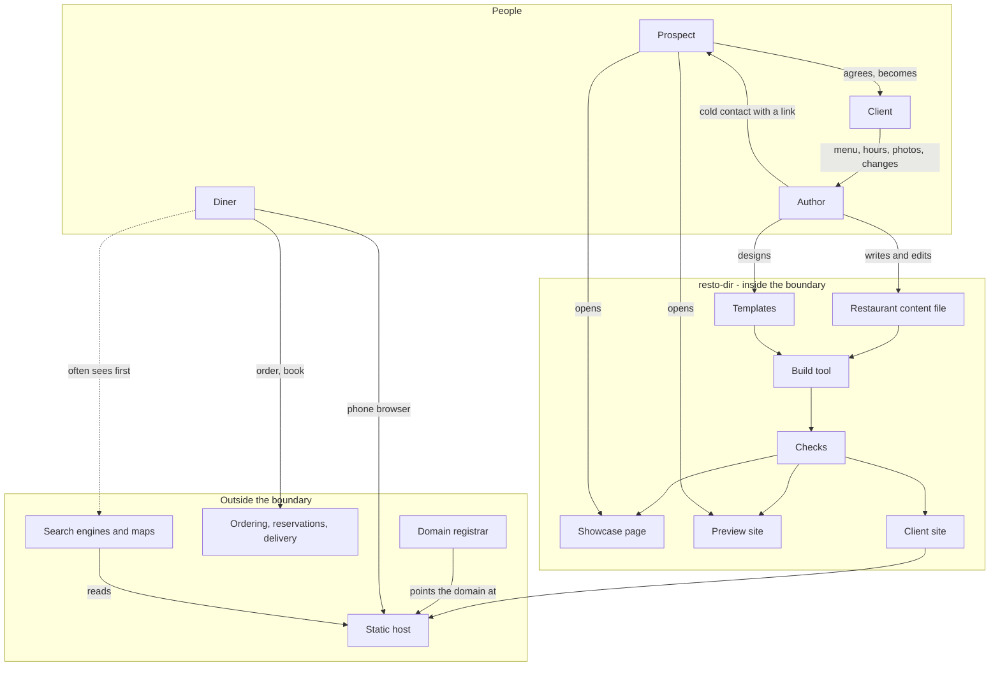

# resto-dir - Interaction and system boundary

## Actors

| Actor | Type | What they want |
| --- | --- | --- |
| Diner | Human, the public | The real user of every site. Is it open, what is on the menu, where is it, call or order. Usually on a phone, often in a hurry, owes the site nothing and leaves if it is slow |
| Prospect | Human, a restaurant owner or manager | A restaurant that has not bought anything. Busy, wary of cold contact, has been pitched by marketing agencies before. Wants to see what they would get without a meeting |
| Client | Human, a restaurant owner or manager | A restaurant that has bought a site. Wants it right, wants changes made fast when the hours or prices change, does not want to learn a tool |
| Author | Human, the builder and seller | Builds the templates, fills in each client's details, publishes the sites, makes the changes, finds the prospects and contacts them. One person |
| Static host | External system | Serves each site's files. Cloudflare Pages is proposed - free, no server, global |
| Domain registrar | External system | Where the restaurant's domain name is registered, in the restaurant's name |
| Ordering, reservation and delivery services | External systems | Toast, Square, ChowNow, OpenTable, Resy, Tock, DoorDash and the rest. The site links to whichever the restaurant already uses |
| Search engines and maps | External systems | Google Search, Google Business Profile, Apple Maps, Bing. Read the site's details; often shown to a diner before the site itself |
| Map provider | External system | Shows the restaurant's location on the page. Keyless: an OpenStreetMap-based map, or a plain link to the diner's own maps app |

## Interaction diagram

The client never touches the build tool or the content file in the first version. They send
the author what changed, and the author publishes it. Self-editing is a later stage, and is
an open question in 00-plan.md.

## What the system is in the business of

- Showing a diner, within a few seconds on a phone, whether the restaurant is open, what it
  serves, where it is and how to reach it.
- Keeping a restaurant's menu as text, so it can be read, searched, translated by the browser
  and changed one price at a time.
- Making one restaurant's details look right in any of the templates, without re-entry.
- Producing a site that runs for years with nothing to maintain except its content.
- Making it quick for the author to go from "a restaurant's public menu" to "a preview link
  in their inbox".
- Being honest in outreach: who is writing, what it costs, how to say no.

## What the system does not care about

- Payments, orders, carts or checkout. The restaurant's ordering service does that.
- Reservations or table management. A button goes to the booking service.
- Diners' identities. No accounts, no newsletter sign-up in the first version, no cookies,
  no tracking beyond a count of visits.
- Reviews. Diners leave them on Google and Yelp; the site does not host or curate them.
- Point-of-sale menu sync. The menu is the content file. Reading menus out of Toast or
  Square is a possible later addition, not a first-version feature.
- Online menu ordering built into the site.
- A general website builder. resto-dir makes restaurant websites and nothing else.
- Writing copy with a hosted language model. The restaurant's words are the restaurant's.
- Many authors, roles or a client dashboard. One author makes the changes.
- Scale beyond what one person can look after: tens of clients, not thousands.

## Main use cases

| ID | Use case | Actor | Result |
| --- | --- | --- | --- |
| U1 | Check if it is open | Diner | "Open now, closes at 9" or "Closed, opens tomorrow at 11", correct for the restaurant's time zone and that day's special hours |
| U2 | Read the menu | Diner | Every dish with price and dietary marks, grouped by section, jump links between menus |
| U3 | Get there or call | Diner | Directions open in the phone's maps app; the number dials on tap |
| U4 | Order or book | Diner | Lands on the restaurant's existing ordering or booking page |
| U5 | Browse the templates | Prospect | Sees each template with a made-up restaurant, on their own phone |
| U6 | See their own preview | Prospect | A private link showing their restaurant in a template, clearly labelled as an unofficial preview |
| U7 | Become a client | Prospect | Agrees a price and a template; the author has a checklist of everything still needed from them |
| U8 | Launch | Author | The site is live on the restaurant's domain over HTTPS, search engines can read it, the checks pass |
| U9 | Change hours or menu | Client, Author | The client sends the change; the author edits one file, the checks run, the site updates |
| U10 | Post a notice | Client, Author | A banner with an end date; it disappears on its own when the date passes |
| U11 | Leave | Client | Gets every file of the site and keeps the domain. Nothing is held hostage |

## Journeys

### J1 - A diner, on a phone, outside

1. Searches the restaurant's name or taps it on a map. Lands on the home page.
2. Above the fold, without scrolling: the name, "Open now - closes at 9pm", the order or
   book button, the phone number and the address.
3. Taps "Menu". Sees section links at the top (Starters, Mains, Drinks), scrolls, sees
   prices and a leaf mark on vegetarian dishes.
4. Taps the address. The phone's maps app opens with directions.

If the page is slow, or the hours are wrong, nothing else about the template matters. Both
are checked for every template at every stage.

### J2 - A prospect, from a cold email

1. Receives a short email from the author: who they are, that they are local (or what they
   specialise in), one line on what is wrong with the current site if anything is - "your
   menu is a PDF", "your site says you open at 10, Google says 11" - and a link.
2. The link opens a preview of their own restaurant in one template, built from their public
   menu and hours. A bar at the top says it is an unofficial preview made by the author, not
   the restaurant's site, and has a link to see the other templates.
3. The email ends with the price, or a line saying where it is, and a plain way to say "not
   interested" that is honoured.
4. If they do not answer, at most one follow-up. If they say no, the preview is deleted.

### J3 - A client, from yes to live

1. Chooses a template on a call or by email.
2. Gets a checklist: menus, hours including holidays, photos, logo, links to their ordering
   and booking pages, who owns the domain.
3. The author fills in the content file, runs the build and the checks, and sends a preview
   link. The client asks for changes; repeat.
4. The client approves. The author connects the domain, publishes, and confirms the details
   on the site match the restaurant's Google Business Profile.

### J4 - A change, after launch

1. The client sends "we close at 8 on Sundays now" by text or email.
2. The author edits the hours in the content file. The checks run.
3. The site is republished. The author tells the client it is done, and reminds them to
   change it on Google too, or does it for them if that is part of the plan.
