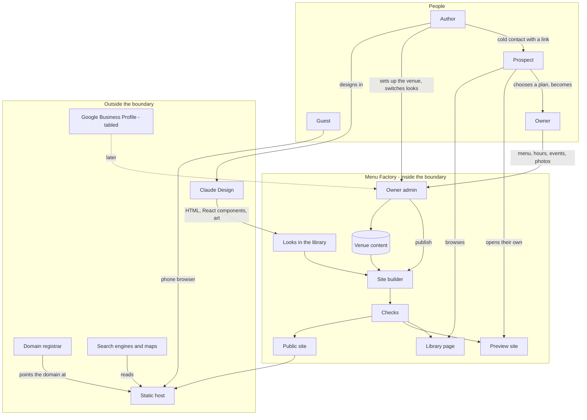

# Menu Factory - Interaction and system boundary

## Actors

| Actor | Type | What they want |
| --- | --- | --- |
| Guest | Human, the public | The real audience of every site. To be won over before they arrive - and to find out quickly whether it is open, what is on the menu and where it is. Usually on a phone. Some want the full show, some want it calm |
| Prospect | Human, a restaurant or bar owner or manager | Has not bought anything. Busy, wary of cold contact. Cares about how the place is seen. Wants to see their own venue in a new look without a meeting |
| Owner | Human, a client's owner or manager | Has bought a plan. Not technical. Wants to change the menu, hours and events themselves, from a phone, without fear of breaking anything. On the monthly plan, wants a new look when they are bored of the old one |
| Author | Human, designer, builder and seller | Designs the looks (with Claude Design for imagery and motion), builds them, sets up each client, finds and contacts prospects, switches looks for monthly clients. One person |
| Claude Design | Tool, used by the author | Where the looks' imagery, motion and visual design are made. Exports standalone HTML whose components are React. Not part of a running site |
| Static host | External system | Serves each venue's public site as files. Cloudflare Pages is proposed |
| Server | External system | The author's one server. Runs the owner admin and its database |
| Domain registrar | External system | Where the venue's domain is registered, in the venue's name |
| Search engines and maps | External systems | Read the public site's details; often shown to a guest before the site itself |
| Google Business Profile | External system, tabled | The source of reviews, once that work is picked up |

There is no ordering, delivery or reservation service in this list. That is deliberate: a
Menu Factory site stands on its own.

## Interaction diagram

The guest never touches the admin or the server. If the server is down, every public site
stays up; only editing pauses.

## What the system is in the business of

- Making a guest want to go before they have arrived.
- Giving a restaurant a website that looks like the place feels.
- Letting the guest choose the full show or a calmer version.
- Letting a restaurant see its own menu in any look, and change look without re-entering
  anything.
- Letting a non-technical owner change their content safely, with a preview and an undo, and
  without any way to change the design.
- Showing a guest, quickly, whether the place is open, what it serves and where it is.
- Being honest in outreach: who is writing, what it costs, how to say no.

## What the system does not care about

- Ordering, delivery, reservations, carts or checkout, from any service.
- Payments.
- Guests' identities. No guest accounts, no newsletter sign-up, no cookies. The only accounts
  are owners' logins to the admin.
- Letting owners edit layout, motion, fonts or art. That is the product, and the author's.
- Point-of-sale menu sync.
- A general website builder.
- Writing copy, or judging reviews, with a hosted language model.
- Many authors, agencies or resellers.
- Scale beyond what one person can look after: tens of clients, not thousands.

## Main use cases

| ID | Use case | Actor | Result |
| --- | --- | --- | --- |
| U1 | Be won over | Guest | The look's full motion and art on arrival, with the content readable from the first moment |
| U2 | Less motion | Guest | One tap swaps the full show for a calm version; the choice is remembered on their device. A device already set to reduce motion starts calm |
| U3 | Check if it is open | Guest | "Open now, closes at 2am" or "Closed, opens at 4pm", correct for late nights and holidays |
| U4 | Is it happy hour | Guest | "Happy hour until 7" while it is on, with happy hour prices marked |
| U5 | Read the menu | Guest | Every drink and dish with price, ingredients and marks |
| U6 | Get there or call | Guest | Directions open in the phone's maps app; the number dials on tap |
| U7 | Browse the library | Prospect | Every look, filtered by kind of place, each with a made-up venue |
| U8 | See their own preview | Prospect | Their venue, with their own menu, photos and logo, in a look, clearly labelled as an unofficial preview |
| U9 | Choose a plan | Prospect | One-time or monthly, a look chosen |
| U10 | Edit content | Owner | Changes a price, marks a drink sold out, adds an event, sees a preview, publishes. Live within a minute or two |
| U11 | Undo | Owner | Goes back to any earlier published version in one step |
| U12 | Switch the look | Owner, Author | Monthly plan. The owner sees their own content in other looks from the admin and asks for one; the author approves and it is published |
| U13 | Post a notice or event | Owner | A banner or an event with dates; gone on its own after the date |
| U14 | Leave | Owner | Keeps the domain and, depending on the plan, the files of a look |

## Journeys

### J1 - A guest, on a phone, at 9pm on a Friday

1. Taps the bar's name on a map. The site opens on the look's opening scene: the art and
   motion arrive around the content, not in front of it. The name, "Open now - closes at
   2am" and the menu link are readable at once.
2. The scene is a lot. A small "less motion" control is in the corner; one tap and the page
   settles into a calm version of the same design. Next visit, it opens calm.
3. Taps "Menu". Section links at the top (Signatures, Classics, Zero-proof, Food). Each drink
   shows its ingredients and price.
4. Taps the address. The phone's maps app opens with directions.

### J2 - A prospect, from a cold email

1. Receives a short email from the author: who they are, that they are in Kansas City, one
   line on why - "your bar has a look; your website doesn't" - and a link.
2. The link opens a preview of their own bar in a look, with their own menu, photos and
   logo. A bar at the top says it is an unofficial preview made by the author, and links to
   the library.
3. The email ends with the two plans and a plain way to say "not interested" that is
   honoured. At most one follow-up. A no deletes the preview.

### J3 - An owner, changing tonight's menu from a phone

1. Opens the admin link, logs in.
2. The first screen is short: Menu, Hours, Happy hour, Events, Notices, Photos, Look.
3. Taps Menu, finds the drink, flips "sold out", changes another price.
4. Taps "Preview": sees the real site with the change, in their look.
5. Taps "Publish". The admin says when it is live. If it looks wrong, "Undo" restores the
   previous version.

Nothing on any of these screens can move, recolour or remove part of the design.

### J4 - Switching the look (monthly)

1. In the admin, the owner taps Look and sees their own menu in each look in the library.
2. Taps "Ask for this look". The author is told.
3. The author checks it with their content, publishes. Menu, hours and photos carried over
   untouched.
