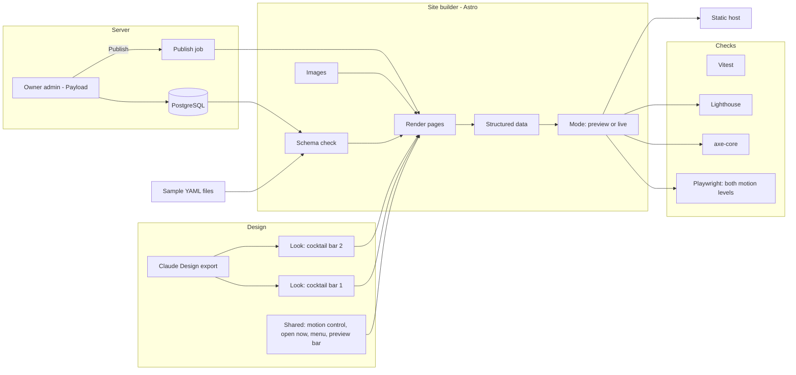

# Menu Factory - Architecture

Internal document. Credentials are referred to by environment variable only.

Nothing here is built yet. This is the design the build starts from, and where it turns out
to be wrong it is changed here first. Every row marked proposed waits for the author.

A **look** is one complete design in the library. In the code it is a folder of components.

## The language

The author asked for "whatever language is most friendly with animations, digital art and
more". In a browser that answer is fixed: **JavaScript is the only language a browser runs
for motion**, and everything the author is likely to reach for - GSAP, Three.js, Lottie,
Rive, the Web Animations API, React - is JavaScript. Claude Design's own exports are
standalone HTML whose components are React.

So the proposal is **TypeScript (JavaScript with types) for the whole project**: the looks,
the site builder, the admin and the tests. One language from the designs to the server
means a content type declared once is checked everywhere it is used.

This is a change from the repository's habit. mailman, roamer and herder are Python. The
earlier draft of this document proposed Python and Jinja for the builder; it is superseded,
because a Python builder would still need JavaScript for every bit of motion and the two
would have to be kept in step by hand.

## Stack

| Part | Choice | Why | Rejected |
| --- | --- | --- | --- |
| Language | TypeScript throughout (proposed) | See above | Python for the builder and admin, JavaScript for motion - two languages for one product |
| Site framework | Astro (proposed) | Built for content sites; outputs plain pages with no JavaScript unless a part asks for it, so a look loads its heavy art only where it is used. Accepts React components directly, which is what Claude Design hands over. Its content collections validate content against a schema | Next.js - an app framework; ships React to every page whether it moves or not. SvelteKit - excellent motion built in, but Claude Design's React components would need rewriting. Plain hand-written HTML - every look re-implements the menu, hours and events |
| Components from designs | React, inside Astro, only where a look needs interactivity or Claude Design produced it (proposed) | Keeps Claude Design's output usable close to as-is | Rewriting every export by hand |
| Timeline and scroll motion | GSAP with ScrollTrigger and its other plugins | The standard tool for this work. Free for commercial use since Webflow made it so, including the formerly paid plugins. Its licence restricts building a visual animation builder that competes with Webflow; owners here edit content, never motion, so that does not apply | A motion library per look |
| 3D and WebGL art | Three.js, with React Three Fiber where a scene sits in a React component (proposed) | The standard for 3D in the browser | Canvas by hand |
| Designer-made animation | Lottie (from After Effects) and Rive, where a design arrives in those formats (proposed) | Lets art made in other tools drop in | |
| Less motion / more motion | A shared control and a single setting every look reads (see below) | The author wants both levels on every site | Each look inventing its own |
| Content schema | Zod, through Astro's content collections (proposed) | One schema checks the sample files now and the admin's data later | A separate schema language |
| Content source | YAML files for the samples and the first clients; the admin's database once stage 4 exists (proposed) | Astro reads either through the same schema, so the looks never notice the switch | Building the admin before the first look |
| Owner admin | Payload CMS, self-hosted, with its screens cut down to what an owner needs (proposed - see Owner admin) | Open source, TypeScript, PostgreSQL. Logins, roles, image uploads, drafts and version history are already built and tested | A hand-built admin - every one of those built and secured from scratch. A hosted CMS (Sanity, Contentful) - an account and key per project, and the content lives with a third party |
| Database | PostgreSQL, on the existing server (proposed) | The server already runs it for mailman | SQLite - fine alone, but the server's backups and tooling are Postgres |
| Images | sharp, at build time and on upload: resize, strip location data, modern formats with a fallback | | |
| Fonts | Served with the site's own files | No outside request per page view | Google Fonts linked live |
| Map | A directions link that opens the guest's own maps app | | A Google Maps embed |
| Visit counts | Cloudflare Web Analytics (proposed) | Free, no cookies | Google Analytics |
| Public sites | Built files on Cloudflare Pages, one project per venue (proposed) | Fast, free, and independent of the server | Rendering each page live from the server - every venue goes down when the server does |
| Tests | Vitest for logic; Playwright in Chrome for pages, both motion levels, phone width and screenshots; axe-core for accessibility; Lighthouse for speed (proposed) | All TypeScript; Playwright can drive the motion control and compare screenshots | |

No part of Menu Factory uses a hosted language model, now or later.

## Static or not

The author is not sure yet whether sites should be static files, because owners need to
change content. The proposal is **both, split where the risk is**:

- **What a guest loads is files.** Built ahead of time, served from a global static host.
  Fast, nothing to attack, and up even when the server is not.
- **What an owner edits is an app.** Logins, a database, uploads, previews, history - on the
  server.
- **Publishing joins them.** When the owner presses Publish, the server builds that venue's
  site from the database and uploads the files. A minute or two from Publish to live.

Live-rendered sites would make Publish instant but tie every venue's uptime to one server.
For pages that change a few times a week, the delay is the better trade.

## Components



## Proposed layout

```
menufactory/              renamed with the product if the name changes again
  brand.ts                the working name and everything else that names the product
  requirements/
  site/                   the Astro project: the site builder and the library page
    src/looks/<look>/     one folder per look: components, styles, motion, art, look.json
    src/shared/           motion control, open now and happy hour, menu, events, preview bar
    src/content/          the schema, and the sample venues as YAML
  admin/                  the owner admin (stage 4)
  tests/
  dist/                   build output - already ignored by the root .gitignore's dist/ rule
```

Each look's `look.json` gives its display name, the kinds of place it suits, its pages, the
photo uses it asks for, whether it accepts the venue's colours, and its weight budget.

`node_modules/` must be ignored: the root `.gitignore` only ignores `/node_modules` at the
repository root, so this project needs its own rule. Checked at stage 0.

Real clients' content, photos, accounts and credentials do **not** live here.

## From a design to a look

1. The author designs in Claude Design and exports. Claude Design offers standalone HTML,
   and a hand-off to Claude Code; the components inside are React. **Stage 0 takes one real
   export through the steps below as a spike**, because how cleanly an export becomes a look
   decides how fast the library can grow.
2. The fixed parts - layout, type, motion, art - stay as the design has them.
3. Every part that belongs to a venue becomes a slot filled from the content: name, logo,
   menu, hours, happy hour, events, notices, photos.
4. The look is rendered with every sample venue and run through the checks in both motion
   levels. A look that only works with its own sample's text is not finished: a long
   cocktail name, an 80-item menu, a venue with no interior photos must all still look
   designed.

## Less motion, more motion

Every site carries a small, always-visible control with two settings:

- **More motion**: the look's full show.
- **Less motion**: the same design, with large movement, parallax, 3D scenes and autoplaying
  video replaced by fades, still frames or nothing. Not a broken or blank version - each look
  designs its calm state.

The rules:

- The starting setting comes from the guest's device. A device set to reduce motion
  (`prefers-reduced-motion`) starts on less.
- The guest's choice is remembered in their own browser only. Nothing is sent anywhere.
- Every look must implement both. The checks run every page in both.
- In both settings: content is readable and tappable from the first moment; nothing that
  moves on its own for more than five seconds lacks a pause (WCAG 2.2.2); nothing flashes
  more than three times a second.

## Content first, the show around it

"All about flash" and "fast on a phone" pull against each other. They are reconciled by
order, not by trimming the art:

1. The text - name, open now, the menu link, the address - arrives in the first response and
   is readable at once. Target: the main content visible within 2.5 seconds on a mid-range
   phone on a mobile connection (proposed).
2. The art and motion load after, around that content.
3. Heavy pieces (3D scenes, video) load only when the guest is about to see them, and only
   in more-motion mode.
4. Each look has a weight budget in `look.json`. The builder fails a look over its budget.
   The numbers are set with the author after the stage 0 spike shows what a real export
   weighs.

## Owner admin

Proposed: **Payload CMS**, run on the server, with its screens cut down for owners who are
not technical. Owners control content, not art. 04-data-model has the full list of what an
owner may change.

- **Short screens.** The first screen is a handful of large buttons: Menu, Hours, Happy hour,
  Events, Notices, Photos, Look. No developer vocabulary anywhere.
- **Works on a phone.** Owners will change a price from behind the bar.
- **Drafts, preview, publish, undo.** Every change is a draft until published; preview shows
  the real look; every published version is kept and any one can be restored.
- **One venue per owner.** An owner sees only their own venue. The author's account sees all.
- **No design controls.** There is no field anywhere that changes layout, motion, fonts or
  art. The look is a name from the library, and switching it is a request the author
  approves (proposed).
- **Uploads checked.** Images only, size-limited, resized and stripped of location data on
  upload.

Payload's real cost is weight: it is a Next.js application, and the server is shared with
mailman. **The stage 4 spike measures its memory use on the server before committing to
it.** If it does not fit, the fallback is a small hand-built admin in Astro's server mode
with the same screens.

How owners log in - a password, or a link emailed to them - is an open question; an emailed
link needs a mail relay.

## Previews for prospects

A preview uses the venue's own menu, photos and logo, so it is a picture of what their site
would be. It is never findable and never passes itself off as theirs:

- Hosted under the author's own domain, e.g. `preview.<author domain>/<slug>`.
- `noindex` on every page and a disallow-all `robots.txt`.
- The preview bar on every page, which a look cannot hide.
- Deleted when the prospect says no, or after a set time without an answer.

## Hosting and publishing

- Each venue's public site is one Cloudflare Pages project. Publishing uploads the built
  files with Cloudflare's own command-line tool; its token is a server secret,
  `CLOUDFLARE_API_TOKEN`, never in a file.
- The admin and its database run on the author's one server, as a compose profile, the same
  way roamer is planned.
- The venue owns its domain; the author is given access to change DNS, never ownership.
- A daily scheduled build per venue drops notices and events whose dates have passed.
- The library page lives on the author's own site with the made-up venues.

## Tabled: Google reviews and how items are perceived

Picked up after the animations and the core idea work (author, 2026-10-23). Recorded here so
the design does not block it.

**Getting reviews.** Two routes, researched 2026-10-23:

| | Business Profile API, at build time | Places API, in the guest's browser |
| --- | --- | --- |
| Gets | Every review and the overall rating | At most five, chosen by Google |
| Needs | Google's approval for the API (days to weeks, often refused if vague; the applicant must manage a Business Profile) and the owner's permission | An API key restricted to the domain, and a billing account |
| Cost | None | Billed per page view after a monthly free allowance |
| Fits a static site | Yes - fetched daily, written into the page | No - Google's terms forbid storing it |

The Business Profile API was the proposal. Whether its terms allow showing reviews on the
business's own site must be checked before building.

**Quotes by sentiment.** Each fetched review is marked good, mixed or bad. In the admin, the
owner chooses which quotes appear on the site - their discretion. The site always also shows
the overall rating, the total count and a link to all reviews on Google, so a selection is
never presented as the whole picture (the US Federal Trade Commission's 2024 rule on consumer
reviews prohibits that misrepresentation).

**How each item is perceived.** An admin view for the owner: for each menu item, how often it
is mentioned in reviews, how many of those mentions are good, mixed or bad, and the quotes
themselves. Items are found by their names in the review text. Sentiment is judged without
any hosted model: a word-list baseline first, then a small model trained and run by the
author, compared on a hand-labelled set - the same pattern as mailman and fallacysuspect.
That model may be Python, trained offline; it runs on the server.

## What is checked before anything is published

| Check | Pass |
| --- | --- |
| Schema | The content validates |
| Unit tests | Hours, happy hour, the brand-name rule, every look rendering every sample |
| Both motion levels | Every page renders and works in more and in less; the control switches and is remembered |
| Accessibility | No axe-core violations at AA, in both motion levels |
| Content first | Main content visible within the target on a simulated mid-range phone |
| Weight budget | Within the look's budget |
| Links | Every internal link resolves |
| Phone width | Every page at 390px with no sideways scrolling, screenshots kept |
| Structured data | Valid in the schema.org validator |
| Preview mode | `noindex` and the preview bar on every page |
