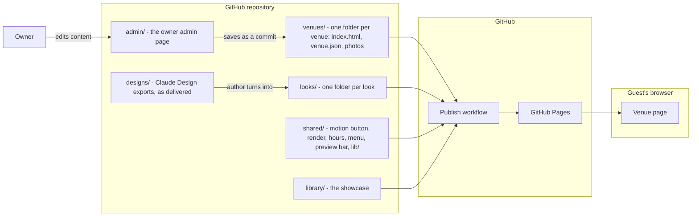

# Menu Factory - Architecture

Internal document. Credentials are referred to by environment variable only.

Nothing here is built yet. This is the design the build starts from, and where it turns out
to be wrong it is changed here first. Every row marked proposed waits for the author.

A **look** is one complete design in the library. In the code it is a folder of files.

## The constraint: GitHub Pages

Everything has to run on GitHub Pages (author, 2026-10-25). GitHub Pages serves files and
nothing else: no server, no database, no code running on its side. The portfolio already
publishes this way - `deploy/build-static.mjs` copies each app's files into `deploy/dist/`
and `.github/workflows/pages.yml` publishes them, with no build step for any app.

So the rule for Menu Factory is the same as pedalsim's and trail's: **the files in the
repository are the files a visitor loads.** No compile step, no framework build, nothing
that only exists after `npm run build`. Development tools (tests, the image resizer) may be
installed with npm on the author's machine and in CI, but nothing they install is published.

This supersedes the earlier proposals of an Astro and TypeScript build (it would add an npm
build to the publish workflow) and of a Payload admin on the server (Pages has no server).

## Stack

| Part | Choice | Why | Rejected |
| --- | --- | --- | --- |
| Hosting | GitHub Pages, through the portfolio's existing publish workflow | The author's constraint | |
| Pages | Plain HTML, CSS and JavaScript modules, no build step (proposed) | The tamest thing that runs on Pages; matches pedalsim and trail; Claude Design's standalone HTML is already this shape, so an export is close to usable as it is | Astro - good, but needs an npm build in the publish workflow; it stays the upgrade path if search engines ever need fully written-out pages. TypeScript - needs a compile step |
| Language | Modern JavaScript. The browser runs it directly, and every motion tool is written for it | The author asked for the language friendliest to animation and digital art; in a browser that is JavaScript | Anything that compiles to it |
| Content | One JSON file per venue, read by the page in the browser (proposed) | Browsers read JSON natively; the admin writes it | YAML - needs a parser sent to every visitor |
| Content check | A schema check run by the tests, and by the admin before it saves | A broken file never reaches a visitor | |
| Timeline and scroll motion | GSAP with ScrollTrigger and its other plugins, as files in the project | The standard tool. Free for commercial use since Webflow made it so; its licence only restricts building visual animation builders, which the admin is not | |
| 3D and WebGL art | Three.js, as files in the project, loaded only by looks that use it | The standard for 3D in a browser | |
| Designer-made animation | lottie-web for Lottie files, the Rive runtime for Rive files, only where a design arrives in those formats | Lets art made in other tools drop in | |
| Third-party code | Copied into `shared/lib/` at a pinned version (proposed) | No dependency on a CDN being up; the version a look was tested with is the one it gets. Named `lib/`, not `vendor/`, because the root `.gitignore` ignores every folder called `vendor/` | Loading from a CDN |
| React in exports | If a Claude Design export's components are React compiled in the browser, they are rewritten as plain modules when the export becomes a look (proposed) | Compiling in the browser downloads a compiler on every visit | Shipping it as exported |
| Motion button | One shared module, a visible button on every page of every site and of the library (settled) | | |
| Open now, happy hour, expiry | Worked out in the browser when the page opens | With no build, there is no daily rebuild; notices and events past their date are hidden by the page itself | A scheduled rebuild |
| Images | Resized and stripped of location data before they are committed: by a script on the author's machine, or by the admin on upload (proposed) | Pages serves exactly what is in the repository | Full-size phone photos |
| Fonts | Files in the project | No outside request per page view | Google Fonts linked live |
| Map | A directions link to the guest's own maps app | | A Maps embed |
| Visit counts | Cloudflare Web Analytics, which is a script and works on any host, or nothing (proposed) | No cookies | Google Analytics |
| Tests | Node's built-in test runner for the logic; Playwright for pages in both motion levels at phone width with screenshots; axe-core for accessibility (proposed) | Development tools only | |
| Owner admin | A git-based admin page served from Pages itself - Sveltia CMS proposed, decided by a stage 4 spike (see Owner admin) | Works with no server: saving is a commit | Payload - needs a server. Decap CMS - the older project Sveltia was built to replace. A Google Sheet - easy, but not the interface the author asked for |

No part of Menu Factory uses a hosted language model, now or later.

## What a page is

A venue's site is a small folder: an `index.html` that names the venue's JSON file, the JSON
file, and the venue's photos. The shared code reads the JSON, sees which look it names, loads
that look's HTML, CSS and motion, and fills the look's slots with the venue's content.

**Switching look is one value in the venue's JSON.** Nothing else changes.

**Search engines.** Because the menu is filled in by the browser, the page's text is not in
the HTML file itself. Google runs JavaScript and reads pages like this; other crawlers do so
less reliably. For the showcase this does not matter. If a paying venue needs it, the upgrade
is a small script that writes the content into the HTML before it is committed - still plain
files on Pages - or Astro. Decided when a client needs it, not before.

## Components



## Proposed layout

```
menufactory/              renamed with the product if the name changes again
  brand.js                the working name and everything else that names the product
  requirements/
  designs/                Claude Design exports exactly as delivered, by category -
    cocktail-bar/         gitignored: never on GitHub, backed up by OneDrive only
    bar/
    restaurant/
  looks/<look>/           a finished look: look.html, look.css, look.js, art/, look.json
  shared/                 motion button, render, open now and happy hour, menu, events,
                          preview bar
    lib/                  GSAP, Three.js and the rest, pinned
  venues/<slug>/          made-up sample venues: index.html, venue.json, photos
  library/                the showcase page
  admin/                  the owner admin (stage 4)
  tests/                  not published
  package.json            development tools only; nothing in it is published
```

Two `.gitignore` facts to act on in stage 0: the root rules do not ignore
`menufactory/node_modules/`, so it needs its own rule; and `vendor/` is ignored everywhere,
which is why third-party code goes in `lib/`.

`designs/` keeps the raw exports so a look can always be compared with what the author
designed. It is ignored by git (root `.gitignore`, menufactory section) and is never
published. New categories are new folders inside it.

Each look's `look.json` gives its display name, its category, the pages it has, the photo
uses it asks for, whether it accepts the venue's colours, and its weight budget.

## Publishing

- `deploy/build-static.mjs` copies `menufactory/` into `deploy/dist/menufactory/`, leaving out
  `requirements/`, `tests/`, `designs/` and anything installed for development.
- `pages.yml` gains a `menufactory/**` path so a push publishes it.
- The showcase is then at `moabboud.dev/menufactory/library/`, each sample venue at
  `moabboud.dev/menufactory/venues/<slug>/`.

**Paying clients' sites.** Each needs its own address on its own domain, and GitHub Pages
gives one custom domain per repository, so each client is its own small repository with
Pages turned on. The same files work there unchanged. One caution, recorded so it is decided
deliberately: GitHub's terms say Pages is not meant to be used as free hosting to run an
online business. A restaurant's information site sold as a paid service may fall on the wrong
side of that. Because the files are plain, the same site moves to Cloudflare Pages (free, and
allows commercial use) with no code change. Open question in 00-plan.

## Protecting the designs

The author asked whether the designs can be hidden from copying tools and from source
control (2026-10-25). The honest line:

- **Anything that never has to reach a guest's browser can be hidden completely.**
- **Anything the live site shows cannot.** To draw a page, the browser must be sent its HTML,
  CSS, JavaScript, images and video. Any browser can save them; "view source", site-copying
  tools and crawlers all take what is public. No setting on GitHub Pages or anywhere else
  changes that. What can be done is to make copying harder, less useful and provable.

The layers, from strongest to weakest:

| Layer | What it does | Status |
| --- | --- | --- |
| Raw designs off GitHub | `designs/` is gitignored; the exports exist only on the author's disk, backed up by OneDrive | Done |
| Readable look source off GitHub | Each look's readable, commented source lives in a private repository (free on GitHub). One script writes a compacted, obfuscated copy into `looks/` for publishing - still plain files, still Pages. The public repository and the live site only ever hold the obfuscated copy | Proposed (P36) |
| A copy does not run elsewhere | The look's code checks it is on an allowed domain and draws nothing otherwise. A determined person can remove the check; a lifted page does not simply work | Proposed (P37) |
| A copy can be proven | An invisible signature in each look's code and art, so a copy can be shown to be one | Proposed (P38) |
| Crawlers asked to stay out | The domain's `robots.txt` asks AI and archive crawlers to keep out of `/menufactory/`. Only well-behaved crawlers obey. Blocking outright would need Cloudflare's proxy turned on for the whole domain, which changes the portfolio's hosting - not proposed now | Proposed (P39) |
| Copyright | The repository has no licence file, so its contents are all rights reserved by default: others may view them, not reuse them. Each look carries a copyright notice; client contracts license the use of a look, never ownership of its code; a copy found online can be taken down with a DMCA notice | In place by default; notices proposed (P40) |

The trade-off of P36: Menu Factory's look code stops being readable in the public portfolio.
The portfolio still shows the requirements, the live library and, if the author wants, the
shared engine. The author's rule is business first, so the proposal favours the business.

Obfuscation can cost a little speed; the stage 0 spike measures it on a real look.

## From a design to a look

1. The author designs in Claude Design and exports standalone HTML into the right category
   folder under `designs/`.
2. **Stage 0 takes one real export through the steps below as a spike**, because how cleanly
   an export becomes a look decides how fast the library can grow.
3. The fixed parts - layout, type, motion, art - stay as the design has them. Third-party
   code it loads is pinned into `shared/lib/`. In-browser React is rewritten as plain modules.
4. Every part that belongs to a venue becomes a slot filled from the venue's JSON: name, logo,
   menu, hours, happy hour, events, notices, photos.
5. The motion button is added, and the look's calm version is designed.
6. The look is rendered with every sample venue and checked in both motion levels. A long
   cocktail name, an 80-item menu, a venue with no interior photos must all still look
   designed.

## Less motion, more motion

A visible button on every page of every site and of the library (settled), with two settings:

- **More motion**: the look's full show.
- **Less motion**: the same design with large movement, parallax, 3D scenes and autoplaying
  video replaced by fades, still frames or nothing. Each look designs its calm state.

The rules:

- The starting setting comes from the guest's device (`prefers-reduced-motion`).
- The guest's choice is remembered in their own browser only. Nothing is sent anywhere.
- Every look implements both. The checks run every page in both.
- In both: content readable and tappable from the first moment; a pause for anything that
  moves on its own for more than five seconds (WCAG 2.2.2); nothing flashing more than three
  times a second.

## Content first, the show around it

1. The text - name, open now, the menu link, the address - appears first.
2. The art and motion load after, around it.
3. Heavy pieces (3D scenes, video) load only when about to be seen, and only on more motion.
4. Each look has a weight budget in `look.json`, checked by the tests. The numbers are set
   after the stage 0 spike shows what a real export weighs.

## Owner admin

Proposed: **a git-based admin, served from GitHub Pages like everything else** - Sveltia CMS
is the leading option, decided by a spike at the start of stage 4.

How it works with no server:

- The admin is a page, `admin/`, on the same Pages site.
- The owner signs in, sees forms for their venue's content only, and saves.
- Saving is a commit of the venue's JSON and photos to the repository. The publish workflow
  republishes; the change is live in a minute or two.
- Every save is in the repository's history, so any earlier version can be restored.

What the owner sees follows the plan already in 02-interaction: a short first screen (Menu,
Hours, Happy hour, Events, Notices, Photos, Look), plain words, usable on a phone, and **no
field anywhere that changes layout, motion, fonts or art** - a test compares the admin's
editable fields with the "may change" list in 04-data-model. The Look screen shows the
owner's content in other looks and sends a request; **the author approves every switch**
(settled).

The costs, to be measured in the spike rather than assumed:

- **Signing in.** A git-based admin signs people in with GitHub, so each owner needs a GitHub
  account and access to their venue's repository. That is a real step for a non-technical
  owner, done once. The spike watches someone do it.
- **One small helper.** GitHub's sign-in needs a short piece of code to hand over the login,
  which cannot run on Pages. Sveltia provides one that runs free on Cloudflare Workers. It is
  the only part not on Pages.
- **Preview and drafts.** Whether the admin can show the change in the real look before it is
  saved, and keep drafts, is checked in the spike, not promised here.
- **Photos.** Resized on upload, if the admin can do it; otherwise the owner's photos are
  resized by the author's script before they are published.

If the spike shows owners cannot manage it, the fallback is the owner sending changes and the
author making them, until something better is chosen.

## Previews for prospects

- Hosted under the author's own domain, `moabboud.dev/menufactory/preview/<slug>/`.
- `noindex` on every page. A `robots.txt` can only sit at the domain root, so the portfolio's
  root `robots.txt` (if it has one) gains a line for `/menufactory/preview/`.
- The preview bar on every page, which a look cannot hide.
- Deleted when the prospect says no, or after a set time without an answer.

## Tabled: Google reviews and how items are perceived

Picked up after the animations and the core idea work. Still compatible with Pages:

- Reviews would be fetched by a scheduled GitHub Actions job (free for public repositories)
  and written into a `reviews.json` beside the venue's file - the site stays plain files.
- Two routes were researched on 2026-10-23: the Business Profile API (every review, owner's
  permission, Google's approval) and the Places API (five reviews, billed per view, may not
  be stored - which rules it out for files on Pages).
- Quotes marked good, mixed or bad, shown at the venue's choice, always beside the overall
  rating, count and a link to all reviews (FTC 2024 rule on consumer reviews).
- Sentiment judged without any hosted model: a word-list baseline, then a model the author
  trains, run in the scheduled job.

## What is checked before anything is published

| Check | Pass |
| --- | --- |
| Schema | Every venue JSON validates |
| Unit tests | Hours, happy hour, expiry, the brand-name rule, every look rendering every sample |
| Both motion levels | Every page works in more and in less; the button switches and is remembered |
| Accessibility | No axe-core violations at AA, in both motion levels |
| Content first | Main content visible before the art finishes loading |
| Weight budget | Within the look's budget |
| No build needed | The published folder works when served as plain files, exactly as Pages will |
| Phone width | Every page at 390px with no sideways scrolling, screenshots kept |
| Preview mode | `noindex` and the preview bar on every preview page |
