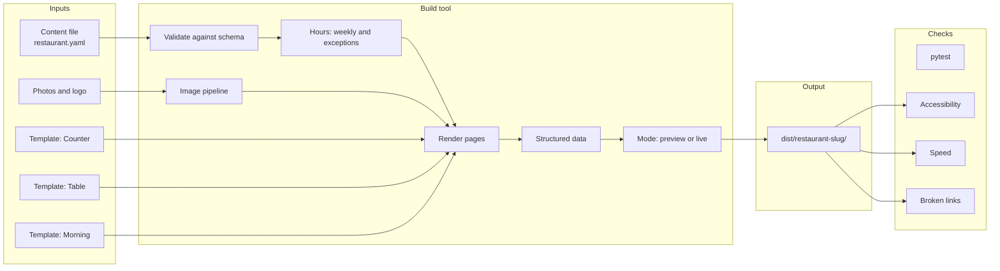

# resto-dir - Architecture

Internal document. Credentials are referred to by environment variable only.

Nothing here is built yet. This is the design the build starts from, and where it turns out
to be wrong it is changed here first. Every row marked proposed waits for the author.

## Stack

| Part | Choice | Why | Rejected |
| --- | --- | --- | --- |
| Client site | Plain static HTML and CSS, a few lines of JavaScript for "open now" and the menu jump links | Nothing to run, patch or secure. Opens fast. Hosts free. Works with JavaScript off, except the live "open now" line | A server-rendered app - a running process per client for pages that change once a month. A site builder - the thing being replaced |
| Build tool | Python and Jinja2, a command that turns one content file and one template into a folder of finished pages (proposed) | Python and Jinja are already used across this repository, run from PowerShell, and need no Node build chain. Output is plain files that any host serves | Rendering the menu in the browser from a JSON file - slower first paint, and search engines read it less reliably. Astro or Eleventy - both good at exactly this, but a second toolchain for one project. Revisit if the Python tool starts reinventing them |
| Styling | Hand-written CSS per template, with custom properties for the restaurant's colours and fonts (proposed) | A template is a design, so its CSS is the template. Custom properties make one restaurant's brand drop into any template | Tailwind from its CDN, as the portfolio's own small apps use - the CDN build compiles in the visitor's browser and is not meant for production. Tailwind with a build step - Node again, for little gain on three templates |
| Content file | YAML, validated against a schema (proposed) | The author edits it by hand. YAML reads like a menu; the schema catches a missing price or a closing time before opening time | JSON - correct but unpleasant to hand-edit. A database - nothing here is relational enough to need one, and every client would need one |
| Images | Pillow, at build time: resize, strip location data, write modern formats with a fallback | Restaurant photos arrive as 8 MB phone pictures. Shrinking them is most of what makes a page fast | An image service or CDN with a key |
| Fonts | Served with the site's own files | No request to a third party on every page view, which is also a privacy point | Google Fonts linked live - an outside request per visit, and a GDPR complaint has been upheld in Germany over exactly this |
| Map | A link that opens the diner's own maps app; optionally a small static map image made at build time (proposed) | A phone diner wants directions, which their own app does best. No key, no embedded tracker | Google Maps embed - loads a heavy third-party frame and needs a key for anything beyond the basic embed. An interactive Leaflet map - weight for little use on this page |
| Visit counts | Cloudflare Web Analytics (proposed) | Free, no cookies, so no cookie banner | Google Analytics - cookies, a consent banner in the EU and UK, more than a restaurant needs |
| Hosting | Cloudflare Pages, one project per client (proposed) | Free tier allows commercial sites, HTTPS and the domain hook-up are built in, and the author's own domain is already at Cloudflare | GitHub Pages - its terms say it is not for running an online business. The moabboud.dev server - one host for the author's portfolio, and if it fails every client goes down with it |
| Tests | pytest: the schema, the hours logic, and a render of every template with every sample restaurant (proposed) | The hours logic is the one piece where a bug is visible to every diner | |
| Accessibility and speed checks | axe-core and Lighthouse run against the built pages in headless Chrome (proposed) | A restaurant buying accessibility needs it checked, not claimed | Checking by eye alone |

No part of resto-dir uses a hosted language model, now or later.

## Components



## Proposed layout

```
resto-dir/
  requirements/          this folder
  resto/                 the build tool (Python package)
  templates/
    counter/             pages, CSS, the template's own sample photos
    table/
    morning/
    _shared/             the open-now script, the structured-data block, the preview bar
  samples/               made-up restaurants, one content file and photo set each
  schema/                the content file schema
  tests/
  showcase/              the page that shows every template with every sample
  dist/                  build output - already ignored by the root .gitignore's dist/ rule
```

Real clients' content files and photos do **not** live here. They live in a private
repository, `resto-clients` or similar, which uses this one's build tool. That keeps the
public repository free of other businesses' material, and means a client leaving is a folder
to hand over.

## How a page is made

1. The content file is read and validated. A missing required field, a price that is not a
   number, an hour range that ends before it starts, or an unknown template name stops the
   build with a message naming the field and line.
2. Photos are resized for the sizes each template uses, stripped of location data, and
   written next to the pages.
3. Each page of the chosen template is rendered: home, menu, and any of about, catering,
   events or gallery that the content file fills.
4. A schema.org `Restaurant` block is written into the home page: name, address, phone,
   cuisine, price range, opening hours and the menu link. Search engines and maps read hours
   from here.
5. The mode is applied. **Live**: normal pages and a `sitemap.xml`. **Preview**: every page
   carries `noindex`, the `robots.txt` disallows everything, and a fixed bar at the top says
   this is an unofficial preview made by the author, not the restaurant's site.

## Open now

The build cannot know the time a diner opens the page, so "open now" is worked out in the
browser by a small script, from the hours written into the page, in the restaurant's time
zone (not the diner's). Without JavaScript the full weekly hours table still shows; only the
live line is missing.

The rules it has to get right, each one a test:

- Hours that cross midnight: a bar open 5pm to 2am is open at 1am on the next calendar day.
- Several ranges in a day: lunch 11 to 2, dinner 5 to 10, closed between.
- Exceptions that beat the weekly hours: closed on Thanksgiving, short hours on Christmas Eve.
- Daylight saving changes.
- "Closes soon" in the last 30 minutes, so a diner does not drive over for nothing.
- Closed for a stretch (holiday, renovation) with a reopening date.

The same function, in Python, feeds the build's own checks and the tests, and the JavaScript
version is tested against the same table of cases.

## Previews for prospects

A preview is built from public information only: the menu, hours and address the restaurant
already publishes. It uses the restaurant's name, because it is a picture of what their site
could be, but it is never findable and never passes itself off as theirs:

- Hosted at an address that is clearly the author's, not one that looks like the restaurant's.
- `noindex` on every page and a disallow-all `robots.txt`.
- The preview bar on every page, which cannot be hidden.
- Deleted when the prospect says no, or after a set time without an answer.
- The restaurant's own photos and logo used only if the author decides the risk is
  acceptable (an open question); otherwise the template's stock imagery with their name set
  in type.

## Hosting and domains

- Each client is one Cloudflare Pages project, published from the private client repository.
- The restaurant registers or keeps the domain in its own name and account. The author is
  given access to change DNS, never ownership.
- HTTPS is the host's, automatic.
- Previews go under a subdomain of the author's own, e.g. `preview.<author domain>/<slug>`.
- The showcase lives on the author's portfolio site with the made-up restaurants.

## What is checked before anything is published

| Check | Pass |
| --- | --- |
| Schema | The content file validates |
| Unit tests | Hours logic and every template rendering every sample |
| Accessibility | No axe-core violations at the AA level on any page |
| Speed | Lighthouse performance 90 or more on a simulated mid-range phone (number proposed) |
| Links | Every internal link resolves; every external link answers |
| Phone width | Every page looked at at 390px wide with no sideways scrolling |
| Structured data | Valid in Google's Rich Results test or the schema.org validator |
| Preview mode | A preview build has `noindex` on every page and the bar on every page |
