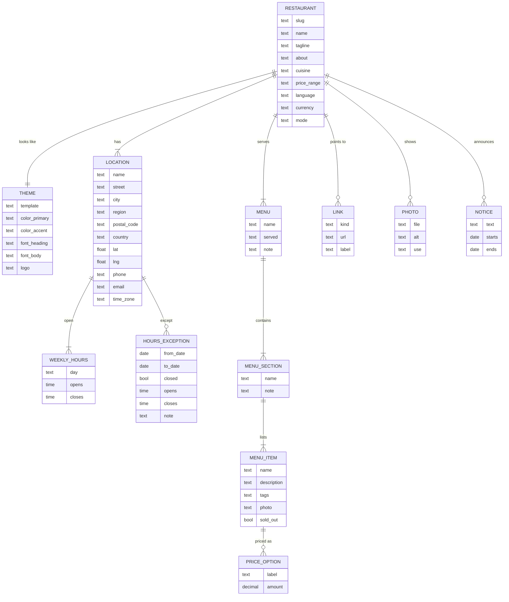

# resto-dir - Data model

There is no database. The data model is the **restaurant content file**: one YAML file per
restaurant, which every template reads. The shape matters more than the exact field names,
and nothing here exists yet.

The rule the whole project rests on: **a template may only use what this file defines.** If
a template needs a field that is not here, the field is added here first, with a sensible
behaviour when it is empty, so every other template and every existing restaurant keeps
working.

## Fields that need a rule

| Field | Rule |
| --- | --- |
| `slug` | Lowercase, hyphens, unique across all restaurants. Names the output folder and the preview address |
| `mode` | `preview` or `live`. Anything else stops the build. Defaults to `preview`, so a restaurant cannot go live by accident |
| `language`, `currency` | Set from the start, even though the first clients are in Kansas City, so an international restaurant is a value change and not a refactor. Prices are formatted from these |
| `price_range` | One to four, shown as `$` to `$$$$` in the restaurant's currency symbol |
| `time_zone` | An IANA name such as `America/Chicago`. Required. "Open now" is wrong without it |
| `WEEKLY_HOURS` | Any number of ranges per day. A range that closes after midnight belongs to the day it opened. A day with no ranges is closed |
| `HOURS_EXCEPTION` | Beats the weekly hours for every date it covers. `closed: true`, or its own opens and closes |
| `MENU.served` | Free text such as "11am to 3pm, weekdays". Display only; it does not drive "open now" |
| `MENU_ITEM.tags` | From a fixed list: `vegetarian`, `vegan`, `gluten-free`, `dairy-free`, `nut-free`, `spicy`, `new`, `house-favourite`. Each has an icon and a text label, never an icon alone |
| `PRICE_OPTION` | One amount for most dishes. Several for sizes ("cup", "bowl"), and none at all for "market price", which is shown as such |
| `LINK.kind` | From a fixed list: `order`, `reserve`, `delivery`, `gift-cards`, `catering`, `instagram`, `facebook`, `tiktok`, `google`, `yelp`, `other`. Templates decide where each kind goes; `order` and `reserve` get the big buttons |
| `PHOTO.alt` | Required. A photo without a description stops the build; this is the accessibility promise, not a nicety |
| `PHOTO.use` | `hero`, `gallery`, `dish`, `interior`, `team`. A template asks for photos by use and falls back gracefully when one is missing |
| `NOTICE` | Shown only between `starts` and `ends`. The site is rebuilt daily (or the check runs in the browser) so an expired notice does not linger - which of the two is open question 6 in 00-plan |

## Multiple locations

A restaurant with two locations is one content file with two `LOCATION` entries, sharing the
menu. A location with its own menu is an open question, deferred until a client needs it.

## What is deliberately not stored

- Anything about diners. There is no form that sends a diner's details anywhere in the first
  version. A catering enquiry is a `mailto:` link or a link to the restaurant's own form.
- Payment details of any kind.
- The restaurant's login details for their ordering, booking, domain or social accounts.
  Domain access is given to the author through the registrar's own sharing, never as a
  password.
- **Business records: prospects, clients, prices agreed, contracts, invoices, outreach.**
  These are the author's business data, about real people. They live outside this public
  repository, in a private tracker. Its shape is in the private context file, not here.
