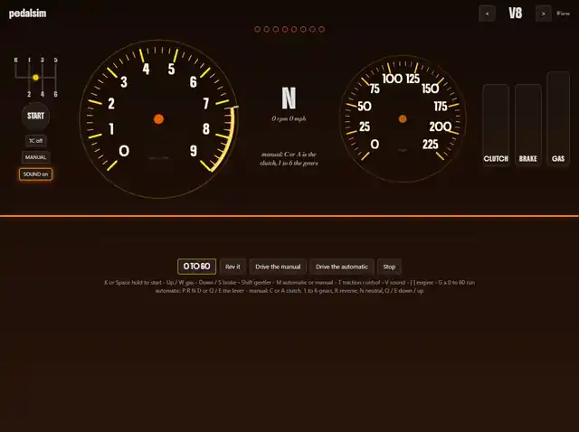

# pedalsim

A car that is only its gauges. Pick an engine from a V4 to a V12, start it, rev it, drive it -
automatic, or manual with a clutch and an H-pattern stick - and run 0 to 60 against the
fastest run the simulation allows for that engine. No road, nothing to steer: the
calculation behind every needle is the point.

**Live: <https://moabboud.dev/pedalsim/>** - press G for a 0 to 60 run.

*A V8 run driven from the keyboard by a test script: 5.899 s against a perfect 4.287 s. The
card splits the 1.612 s gap by phase - most of it wheelspin in first, and a 1-2 shift at
7100 rpm where the perfect run changes up at 5600.*

**Status: all eight stages are built.** 206 tests. Not yet done: anyone but the author
driving it from a keyboard cold, and a real phone (it has only been checked at phone sizes in
Chrome). The plan, the reasoning behind every
decision and what was tried and dropped are in [requirements/](requirements/).

## What is in it

- **Engines built from their measurements.** Each of the five copies the bore and stroke of a
  real naturally aspirated engine (the V4 borrows a 2-litre four's, there being no modern car
  V4 of that size); its torque curve, friction, redline,
  starter and idle are worked out from those, and a test holds its peak torque, peak power and
  redline inside that real engine's published figures. Nobody drew a torque curve.
- **A drivetrain that grips or slips.** The clutch, the rear tyres and the brakes are three
  friction joints solved together each millisecond, so a car can stall, spin its wheels, lock
  up a downshift or creep in Drive for the same reasons a real one does. The automatic has a
  torque converter, a shift map and traction control.
- **Gauges laid out from each engine's figures** - range, tick spacing, redline, one shift
  light per cylinder - so a V12's dials come out different from a V4's. A coach says when to
  change up and down, and shows the revs to match on a downshift. The sound is made from each
  engine's own firing pulses, pitched at its firing frequency.
- **The perfect run.** `tools/solve.js` searches for each engine's fastest clean 0 to 60 in the
  manual, driven no faster than the page's own keyboard allows: pedals at the key ramps' rates,
  inputs every 10 ms at most, wheelspin felt 0.15 s late. The answers are stored and replayed by
  a test. It found things worth knowing - the V8 is quickest changing up 1800 rpm before its
  redline, and without a rule that the car leaves in first, the big engines would set off in
  second and never shift at all.
- **A score card that adds up.** A run is cut into the launch, each gear and each shift by
  what the driver did. Each phase is charged its time less the time the perfect run took over
  the same speeds, so the losses add up exactly to the gap - and still do once rounded to
  milliseconds on the card. A chart draws your speed against the perfect run's with each
  phase's loss shaded between them. Score = 1000 x perfect time / your time.
- **The maths, shown as it happens.** A panel under the gauges, open from the start and hidden with MATHS (or H), shows the
  drivetrain as a chain - engine, clutch, gearbox, tyres, car, brakes - with what each link is
  carrying and whether each friction joint is gripping or slipping, and under it the sums with
  this moment's numbers in them, down to `a = (tyres - air - rolling - brakes) / mass`. It is
  the simulation's last step run again from the same state, so the numbers are exactly what the
  car did - a test checks that they add up to Newton's second law every time.

## Run it

Node 20 or later (CI runs 24), from PowerShell. There is no install step and no dependency.

    cd pedalsim
    npm test                          206 tests, a few seconds
    npx --yes serve .                 then open the address it prints

`npx serve` matters: the page is ES modules, and a server that sends `.js` as `text/plain`
(Python's `http.server` on some machines) stops them loading.

Keys: K or Space held starts it, Up / W gas, Down / S brake, M manual or automatic, G a 0 to 60
run, H the maths panel. In the manual: C or A the clutch, 1 to 6 the gears, N neutral. The on-screen pedals, lever
and stick work with a mouse or two thumbs, and a game controller works too.

The working tools, none of which the page needs:

    node tools/figures.js                       every engine's figures against its targets, and its perfect run
    node tools/solve.js --check                 are the stored perfect runs current
    node tools/solve.js                         solve them again (about ten minutes)
    node tools/drive.js test/scripts/workout.json --engine v12 --out traces/v12.csv

## No server, and what a shared run proves

The page is static and keeps nothing: no account, no cookies, no local storage. Every refresh
starts over; while it is open, the board holds this visit's runs.

**SHARE** puts a run in the link - its inputs only, packed and compressed after `#run=`, which
the browser never sends to any server. Whoever opens it gets the run re-driven from those
inputs on their own page, which works out the time and the score for itself, so a link cannot
be edited into a better time. The simulation gives the same numbers on every machine: it uses
no `Math.sin`, `exp` or `pow` (which browsers may round differently), steps a fixed 1000 times a
second, and a test fails if its output moves without its version number moving. A run driven
in Chrome is kept in the tests and must score identically in Node.

What a link does **not** prove is that a person drove it. A program can write a perfect list
of inputs as easily as a person can press them. A shared run shows that the run is possible in
this simulation, and the page says so.

## Made with

Plain JavaScript modules, no framework and no build step; WebGL2 for the gauge faces with a
canvas fallback; an AudioWorklet for the engine note; `node --test`. Published to GitHub Pages
by the repository's site workflow. Credits for the look, the fonts and the engine figures are
in [CREDITS.md](CREDITS.md).
